# PVZ 3D · 疯狂戴夫的庭院

使用 Godot 制作的《植物大战僵尸》3D 玩法原型。主界面提供**冒险模式**和**演示模式**：两个模式都使用疯狂戴夫的第一人称腰部视角；冒险中右手持苗种植、持铲铲除，演示中可探索庭院、观察交战和进入房屋。

当前冒险模式已实现 **1-1～5-10 共 50 关**，包含五个大关、逐关奖励与有限波次、保龄球、打僵尸、小僵尸、三组砸罐子、暴风雨、蹦极闪电战和僵王战斗。支持右手种植/铲除、底座/南瓜叠放、昼夜、水路、浓雾、屋顶坡面、图鉴与保存进度。演示模式包含五个独立场景，累计展示 40 种基础植物、覆盖 26 种图鉴僵尸；在演示中按 **0** 可进入原先的五路交战。

版本变化见 [更新日志 CHANGELOG.md](CHANGELOG.md)，后续开发的同步维护约定见 [AGENTS.md](AGENTS.md)。

独立制作的[普通僵尸参考模型](assets/3D/normal_zombie/README.md)已按用户选定的 B 组三视图优化饱满后脑、连续眼窝/肩部、手部、服装、材质与灰绿色小腿，提供 GLB、Blender 源文件及真实模型转面预览；该资源尚未接入游戏，原有僵尸与玩法保持原样。

按原始图片新生成的[普通僵尸三视图候选](assets/3D/normal_zombie_reference_sheets/README.md)包含 A–D 四套全身/头部视角，A/B/C 已将左小腿统一为灰绿色；B 组已选作本轮模型优化参考，候选图片保留用于对比。

原版五个冒险大关的植物解锁、僵尸出场、特性与数值参考见 [plan.md](plan.md)，包括商店植物和特殊关附录。场景名单与基础数值以该文档为依据；实际演示规则与实现范围见下文。

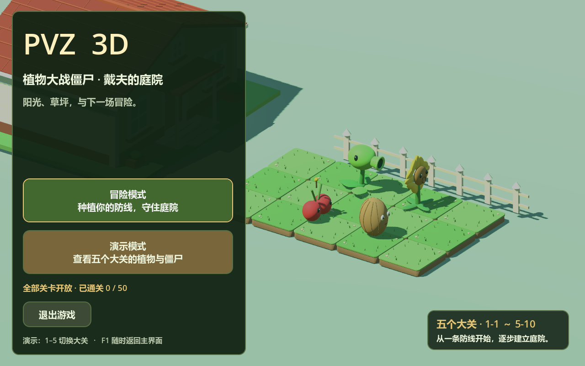

## 快速开始

项目已使用 **Godot 4.7.2** 验证，渲染方式为 **Compatibility**。建议使用同一版本打开；运行游戏只需 Godot，Python 用于可选的场景生成工具。

1. 克隆本仓库，或下载仓库 ZIP 后解压。使用 Git 时可执行：

   ```powershell
   git clone https://github.com/Florenkin/PVZ_3d.git
   ```

2. 在 Godot 项目管理器中点击“导入”，选择仓库根目录的 [project.godot](project.godot)。
3. 等待首次资源导入完成，按 **F5** 运行项目，入口为 [scenes/game.tscn](scenes/game.tscn)，默认进入主界面。
4. 点击“冒险模式”，从 1-1 开始：WASD 移动、鼠标瞄准；空手时右键打开植物选择面板（世界暂停），点击植物后恢复游戏，瞄准草坪格左键种植。左键也可收集阳光，完成后可继续下一关。
5. 点击“演示模式”查看原来的场景；其中 **1–5** 切换大关，**M** 查看全景，戴夫视角用 WASD 移动。任意模式按 **F1** 返回主界面。

冒险的植物需要手动种植，僵尸按有限波次进入；演示继续使用固定布局与自动刷新。

## 游戏内容与玩法

### 冒险模式：白天与夜晚前院

| 关卡 | 有效路径 | 可用植物 | 初始阳光 | 波数 | 通关奖励 |
| --- | --- | --- | --- | --- | --- |
| [1-1](scenes/adventure/level_1.tscn) | 中间 1 行 | 豌豆射手 | 150 | 4 | 向日葵 |
| [1-2](scenes/adventure/level_2.tscn) | 中间 3 行 | 豌豆、向日葵 | 50 | 6 | 樱桃炸弹 |
| [1-3](scenes/adventure/level_3.tscn) | 中间 3 行 | 豌豆、向日葵、樱桃 | 50 | 8 | 坚果 |
| [1-4](scenes/adventure/level_4.tscn) | 全部 5 行 | 豌豆、向日葵、樱桃、坚果 | 50 | 10 | 铲子 |

后续常规关使用此前奖励的全部植物，特殊关提供专用卡牌。1-5 起全部开放五行：

| 关卡 | 玩法 / 新敌人 | 波数 | 通关奖励 |
| --- | --- | --- | --- |
| [1-5](scenes/adventure/level_5.tscn) | 坚果保龄球：普通 / 爆炸坚果供应 | 8 | 土豆雷 |
| [1-6](scenes/adventure/level_6.tscn) | 撑杆僵尸首次登场 | 10 | 寒冰射手 |
| [1-7](scenes/adventure/level_7.tscn) | 普通、路障、撑杆 | 20 | 大嘴花 |
| [1-8](scenes/adventure/level_8.tscn) | 铁桶僵尸首次登场 | 10 | 双发射手 |
| [1-9](scenes/adventure/level_9.tscn) | 白天混合阵容 | 20 | 僵尸便条 |
| [1-10](scenes/adventure/level_10.tscn) | 白天传送带，七种植物 | 20 | 小喷菇 |
| [2-1](scenes/adventure/level_11.tscn) | 夜晚、墓碑、读报僵尸首次登场 | 10 | 阳光菇 |
| [2-2](scenes/adventure/level_12.tscn) | 夜晚经济与混合阵容 | 20 | 大喷菇 |
| [2-3](scenes/adventure/level_13.tscn) | 铁门僵尸首次登场 | 10 | 墓碑吞噬者 |
| [2-4](scenes/adventure/level_14.tscn) | 清墓碑，普通、路障、撑杆、铁门 | 20 | 可打开的植物与僵尸图鉴 |
| [2-5](scenes/adventure/level_15.tscn) | 打僵尸：木锤敲击，专用出怪 | 10 | 魅惑菇 |
| [2-6](scenes/adventure/level_16.tscn) | 橄榄球僵尸首次登场 | 10 | 胆小菇 |
| [2-7](scenes/adventure/level_17.tscn) | 普通、路障、铁门、橄榄球 | 20 | 寒冰菇 |
| [2-8](scenes/adventure/level_18.tscn) | 舞王与四个方向的伴舞 | 10 | 毁灭菇 |
| [2-9](scenes/adventure/level_19.tscn) | 夜晚混合阵容 | 20 | 僵尸便条 |
| [2-10](scenes/adventure/level_20.tscn) | 夜晚传送带，七种植物 | 20 | 睡莲（供后续泳池使用） |

后续三十关继续按此前奖励提供累计植物，特殊关使用专用供应：

| 关卡 | 新内容 / 玩法 | 波数 | 通关奖励 |
| --- | --- | --- | --- |
| [3-1](scenes/adventure/level_21.tscn) | 六行泳池、睡莲、水路救生圈形态 | 10 | 倭瓜 |
| [3-2](scenes/adventure/level_22.tscn) | 水陆混合、铁桶与橄榄球 | 20 | 三线射手 |
| [3-3](scenes/adventure/level_23.tscn) | 潜水僵尸 | 20 | 缠绕海草 |
| [3-4](scenes/adventure/level_24.tscn) | 泳池组合关 | 30 | 商店钥匙 |
| [3-5](scenes/adventure/level_25.tscn) | 小僵尸大麻烦、四种免费供应 | 20 | 火爆辣椒 |
| [3-6](scenes/adventure/level_26.tscn) | 冰车、冰道与四人雪橇 | 20 | 地刺 |
| [3-7](scenes/adventure/level_27.tscn) | 车辆、地刺与水路 | 30 | 火炬树桩 |
| [3-8](scenes/adventure/level_28.tscn) | 海豚骑士 | 20 | 高坚果 |
| [3-9](scenes/adventure/level_29.tscn) | 泳池组合关 | 30 | 僵尸便条 |
| [3-10](scenes/adventure/level_30.tscn) | 八种植物的泳池传送带 | 30 | 海蘑菇 |
| [4-1](scenes/adventure/level_31.tscn) | 六行夜晚泳池、浓雾、小丑 | 10 | 路灯花 |
| [4-2](scenes/adventure/level_32.tscn) | 路灯花照明 | 20 | 仙人掌 |
| [4-3](scenes/adventure/level_33.tscn) | 气球僵尸 | 10 | 三叶草 |
| [4-4](scenes/adventure/level_34.tscn) | 吹雾与反空 | 20 | 墨西哥卷饼 |
| [4-5](scenes/adventure/level_35.tscn) | 五行夜晚前院、三组砸罐子 | 三组 | 裂荚射手 |
| [4-6](scenes/adventure/level_36.tscn) | 矿工绕后 | 10 | 杨桃 |
| [4-7](scenes/adventure/level_37.tscn) | 多向输出与矿工 | 20 | 南瓜 |
| [4-8](scenes/adventure/level_38.tscn) | 跳跳僵尸、南瓜叠放 | 10 | 磁力菇 |
| [4-9](scenes/adventure/level_39.tscn) | 浓雾组合关 | 20 | 僵尸便条 |
| [4-10](scenes/adventure/level_40.tscn) | 暴风雨、闪电视野、五种免费供应 | 20 | 卷心菜投手 |
| [5-1](scenes/adventure/level_41.tscn) | 五行屋顶、预置花盆、投手、蹦极 | 10 | 花盆 |
| [5-2](scenes/adventure/level_42.tscn) | 花盆种植与坡面 | 20 | 玉米投手 |
| [5-3](scenes/adventure/level_43.tscn) | 梯子，末波蹦极 | 20 | 咖啡豆 |
| [5-4](scenes/adventure/level_44.tscn) | 白天定点唤醒，末波蹦极 | 30 | 浇水壶 |
| [5-5](scenes/adventure/level_45.tscn) | 蹦极闪电战、四种免费供应与空投 | 20 | 大蒜 |
| [5-6](scenes/adventure/level_46.tscn) | 投石车，末波蹦极 | 20 | 叶子保护伞 |
| [5-7](scenes/adventure/level_47.tscn) | 保护伞阻挡偷植物与投掷 | 30 | 金盏花 |
| [5-8](scenes/adventure/level_48.tscn) | 巨人、半血投小鬼，末波蹦极 | 20 | 西瓜投手 |
| [5-9](scenes/adventure/level_49.tscn) | 屋顶总攻 | 30 | 僵尸便条 |
| [5-10](scenes/adventure/level_50.tscn) | 夜晚屋顶、六种免费供应、40000 HP 僵王 | Boss 战 | 银向日葵奖杯 |

前院与屋顶为 5×9 格，泳池与浓雾为 6×9 格、中间两行水路，4-5 使用五行前院。未开放的行显示为泥地，不能种植，也不刷僵尸。波数、开放行、初始阳光和奖励顺序依据原版首轮冒险；砸罐子与 Boss 使用独立的完成条件。植物选择面板按当前关卡提供已解锁卡牌。

空手时**右键**打开植物选择面板，世界暂停，戴夫也停止移动；点击可用卡牌或在面板内按 **1–9** 选择前九张，其余卡牌可点击选择，面板支持滚动。阳光不足、冷却中或没有传送带库存的卡牌不可选择。选择后，戴夫右手托着 **0.32 倍**大小的植物模型，瞄准草坪格会显示实际大小的半透明植物和格子预览；鼠标锁定时使用中央准星，释放鼠标时使用指针位置。墙体、地面和僵尸会遮挡草坪选取。右键或 Esc 可取消面板；持苗时右键放回空手。

豌豆费用 **100**、向日葵 **50**、樱桃 **150**、坚果 **50**；种植成功才扣费，卡牌冷却分别为 **7.5 / 7.5 / 50 / 30 秒**。阳光不足、卡牌未冷却、泥地、场外或已有植物的格子会拒绝种植，不扣阳光。有效落点标绿，已有植物或无法使用的格子标红，泥地与场外不显示预览；种植成功后右手恢复空手。

天空与向日葵产出的中阳光均为 **25** 点，需左键收集；1-1 等第一株豌豆种下后才开始阳光与进攻计时。普通植物 300 HP、坚果 4000 HP；普通僵尸 270 HP、路障本体 270+头甲 370=640 HP，默认啃食 100 HP/秒。樱桃种下后默认 **1.2 秒**引爆，附近 3×3 范围伤害 1800；冒险里的植物死亡/消耗与僵尸死亡均不会自动补回。

每条有效路径有一台一次性割草机，敌方僵尸接近庭院左端时自动启动并扫清同路目标；用完后，后续敌人越过左侧房屋边界则判负。全部波次已生成且存活敌方僵尸全部清除才判胜；魅惑友军不触发割草机、失败或阻止胜利。暂停、胜利与失败会停止种植、生产和战斗。可重试当前关、继续下一关或返回选关/主界面。

**全部 50 关默认开放**，新存档和旧存档均可任意选择 1-1～5-10。胜利后逐关保存实际完成记录到 `user://adventure_progress.json`，跳关不会把前面的关卡标成已通关，失败、重试或退出不增加完成记录；各关可用植物仍按关卡预设提供。旧的前四关、前二十关存档自动保留已通关范围。选关页面有五个大关，列表可滚动；通关 2-4 或更后面的关卡后开放图鉴，按最高通关关卡展示内容。完成 5-10 获得奖杯，累计实际完成全部 50 关后主界面才显示冒险全部完成，没有第 51 关。钥匙、卷饼和浇水壶为当前关卡的剧情奖励；商店与禅境花园留待后续实现。

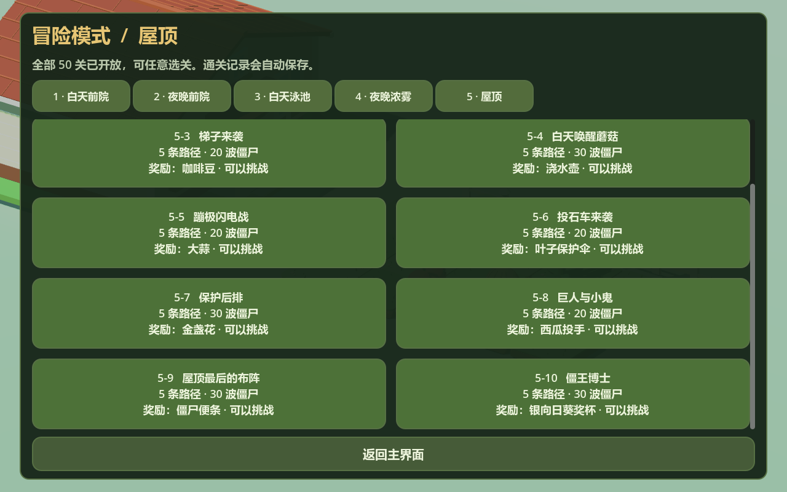

1-5 及后续关卡直接提供铲子；前四个教学关在通关 1-4 后提供铲子。用**滚轮**切换空手/铲子，右手持铲，瞄准格子**左键铲除**，不退阳光；铲除后继续持铲。切回空手、选植物或按右键收起时，同一把铲子回到戴夫背部。

夜晚没有天降阳光，蘑菇清醒。小喷菇免费、射程三格；阳光菇费用 25，幼体产 15 阳光，120 秒成长后产 25；大喷菇可穿过铁门盾牌并攻击同路多个目标。墓碑阻止普通种植，墓碑吞噬者只能种在指定墓碑上，默认 4 秒后清除并消失；最后一波从剩余墓碑冒出僵尸。魅惑菇被吃后让敌人转身，与敌方相互啃食；舞王会补回缺失的伴舞。寒冰菇种下默认 1 秒后全场造成 20 伤害、冻结 4 秒并减速；毁灭菇默认 1 秒后造成 1800 范围伤害、清除附近墓碑，留下默认 180 秒不能种植的弹坑。土豆雷需默认 15 秒准备后才会接触引爆。

**1-5 坚果保龄球**使用免费供应，在红线左侧三列左键投出；普通坚果当前每次造成 400 伤害并弹向相邻行，同一目标只命中一次；红坚果接触后在约 3×3 格范围造成 1800 伤害。**1-10 / 2-10 传送带**默认每 4 秒补一张，最多 10 张；选择和取消不消耗，成功种植才扣一张，没有阳光费用或卡牌冷却。库存按类型显示并通过右键面板选择；墓碑清完后不再补墓碑吞噬者。

**2-5 打僵尸**默认右手持木锤，左键瞄准敲击，当前每次 500 伤害，普通/路障/铁桶分别需要 1/2/3 次；击杀掉落 25 阳光。专用波次让这三种僵尸从墓碑处冒出，初始阳光为 0。滚轮在空手、木锤、铲子之间切换；空手右键可购买樱桃、土豆雷和墓碑吞噬者。

**水路与叠放**：先放睡莲，再放陆生植物；海蘑菇、缠绕海草可直接种在水里，土豆雷和地刺不能放在水路。屋顶先放花盆，所有屋顶关预置前三列花盆，5-1 尚未解锁花盆卡时使用这些底座。南瓜作为独立外壳保护同格植物，咖啡豆只接受同格睡眠蘑菇，默认 1.5 秒后唤醒。铲除顺序为普通植物、南瓜、底座；只铲顶部保留底座，底座被毁会同时移除上层。屋顶前段坡面挡住低平弹体，投手抛物线可以越过。

水路普通/路障/铁桶使用救生圈并保留原护甲；水路专用敌人自动进入水路，车辆、矿工等走陆路。泳池末波额外从两条水路冒出敌人。冰车碾压并留冰道，冰道当前 30 秒融化，期间禁止种植；雪橇沿已有冰道生成四名独立成员，辣椒清除同路冰道。潜水会隐藏，靠近植物时浮出；海草可攻击潜水敌人。气球不触发割草机，仙人掌扎破气球与三叶草吹走可处理它；矿工从后排转向，裂荚射手向后连射。蹦极约 6 秒后离场；保护伞阻挡附近九格的偷植物、空投及投石车投掷。

**浓雾**：路灯花局部照明，三叶草种下后无须等待气球即可触发、当前清雾 25 秒。4-10 暴风雨默认每 12 秒闪电、照亮 2 秒。**3-5** 免费供应睡莲、坚果、豌豆和樱桃，当前僵尸模型/碰撞和生命均为普通的 0.5 倍、速度为 1.5 倍，发射高度同步缩小。

**4-5 砸罐子**：空手或持铲时瞄准罐子左键打碎，获得免费植物卡或放出敌人；罐子阻止种植。三组分别有 15/20/25 罐，后两组有绿色植物罐。清空罐子和敌方后，暂停等待“继续下一组”，重建下一组；全部三组清空才判胜。所得卡牌没有自动补给或冷却。**5-5 蹦极闪电战** 使用花盆、大嘴花、南瓜和樱桃免费供应，并有蹦极空投。

**5-10 僵王**：夜晚蘑菇清醒，提供花盆、西瓜、辣椒、卷心菜、玉米、寒冰菇。Boss 本体为 40000 HP，闭头时不可伤害，割草机不能秒杀；伸头时所有行投手可以瞄准。默认首个伸头在 3 秒后，持续 9 秒，闭头间隔 18 秒；每 20 秒推进一次召唤、冰火球、蹦极、前排踩踏或房车砸落。供应随现有底座与重复库存调整权重，给补回防线留出时间。寒冰菇消除全部火球并冻结僵王，辣椒消除同路冰球；球碾过植物、进入房屋则失败。击败僵王并清除剩余敌人后获得最终奖杯。

| 冒险操作 | 功能 |
| --- | --- |
| WASD / 方向键 | 移动戴夫；S 为后退 |
| 鼠标移动 | 第一人称瞄准，用中央准星指向草坪或阳光 |
| 空手右键 | 打开植物选择面板，同时暂停世界 |
| 面板中的卡牌 / 1–9 | 把可用植物放入右手，恢复世界时间；超过九张的卡牌点击选择 |
| 左键草坪 / 敌人 | 种植、铲除、保龄球投出或用木锤敲击 |
| 左键阳光 | 优先收集阳光，不同时种植物 |
| 滚轮向上 / 向下 | 空手与已解锁的铲子之间切换；打僵尸另有木锤；持苗时切回空手 |
| 持苗 / 持铲右键 | 收回当前物品，恢复空手，铲子挂回背部 |
| 面板内右键 / Esc | 取消植物选择，恢复世界时间 |
| 游戏中 Esc / 暂停按钮 | 暂停或继续；冷却、掉阳光、波次、战斗、掉落物、特效和戴夫移动全部停止 |
| R | 重新开始当前关，恢复初始阳光、空场地与割草机 |
| F1 / 主界面按钮 | 返回主界面，释放当前游戏场景 |

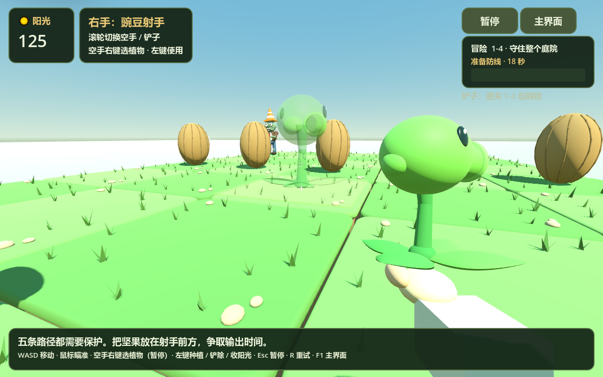

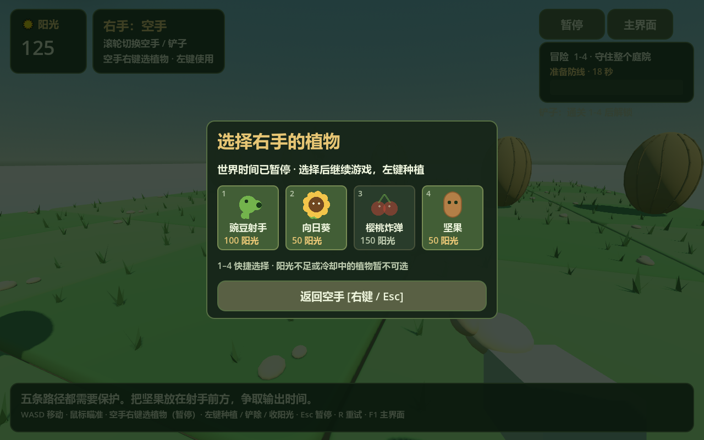

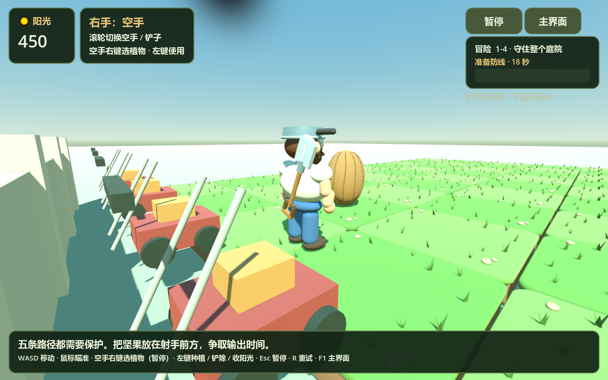

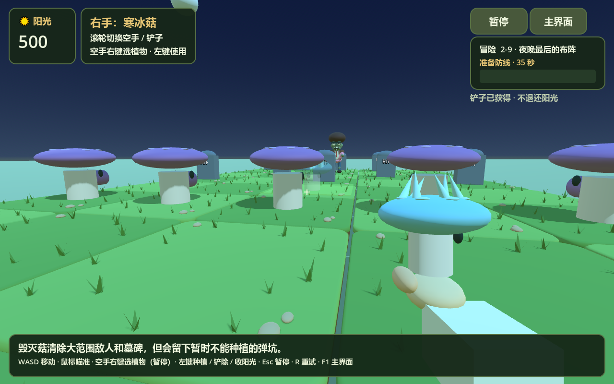

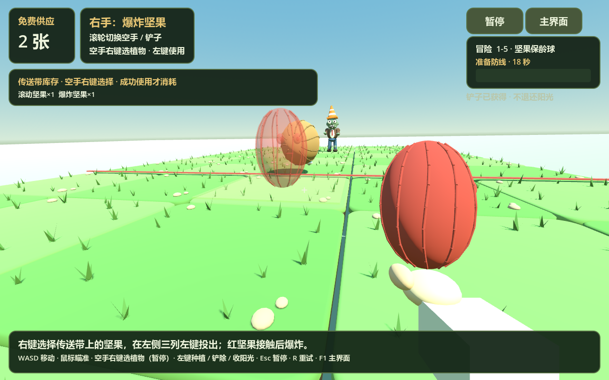

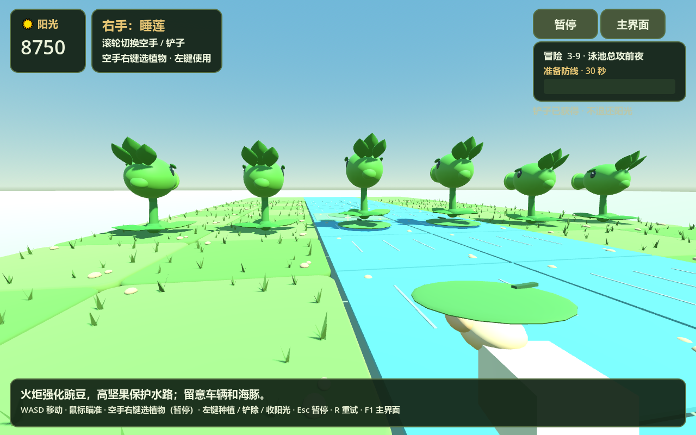

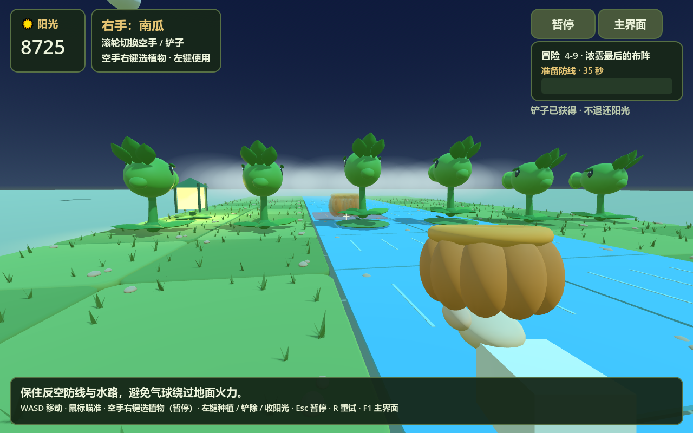

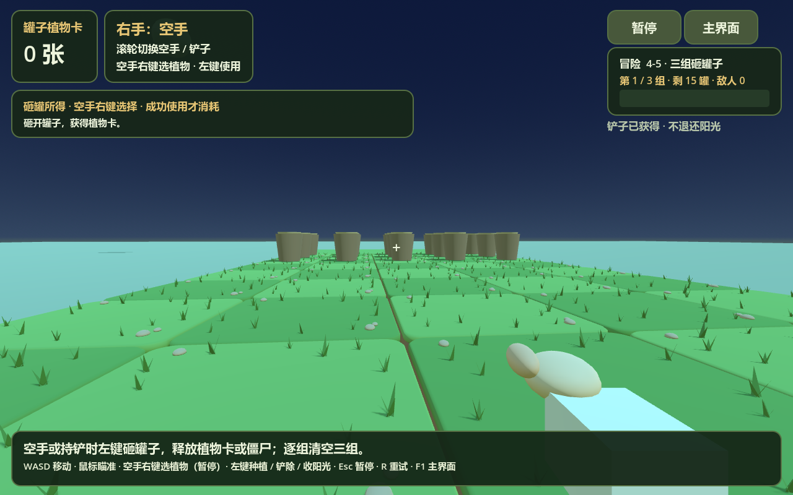

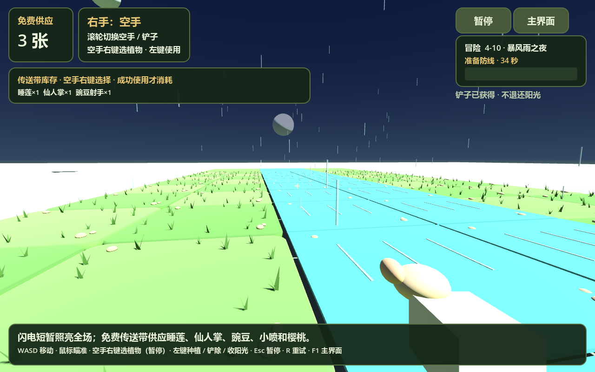

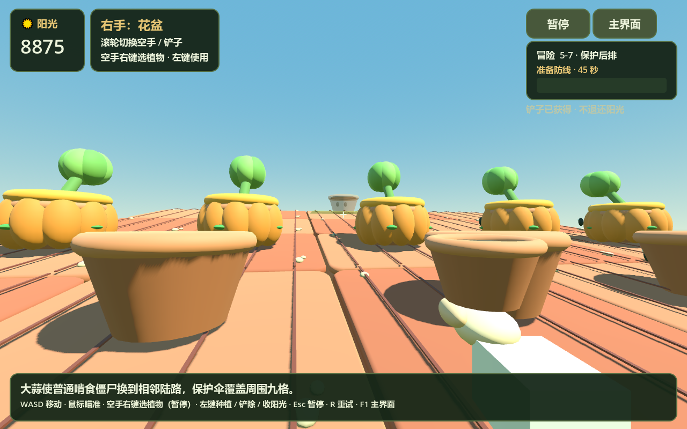

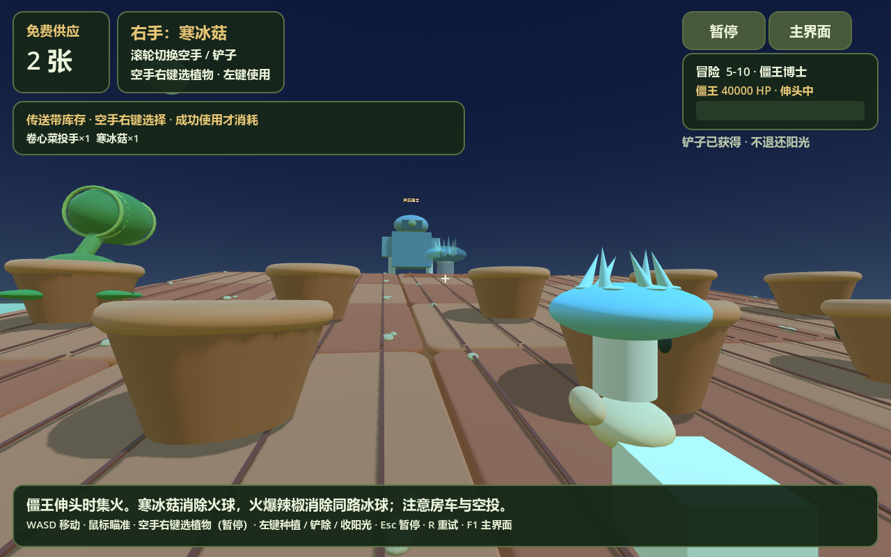

当前复刻首轮五个大关的结构、奖励、候选与波数；波次随机、出场间距、地形/墓碑布局、特殊挑战和僵王攻击节奏采用当前 3D 实现，传送带以库存面板呈现。没有逐帧复制原版教学对白、出怪随机权重、音乐、精细动画与奖励落地动画；首轮不刷二周目雪人。结构与验证说明见 [冒险实现说明](docs/adventure.md)。

### 演示模式

演示中，玩家扮演疯狂戴夫，从植物阵线后方以腰部相机视角观察场地，也可查看全景。植物与僵尸采用固定布局，可移动、查看模型、观察交战、探索房屋，以及使用手持铲子移除植物。

### 演示道具与铲除

进入演示时默认空手，**滚轮向上/向下**在“空手”和“铲子”之间循环切换，右上角显示当前道具。装备铲子后，戴夫右手显示木柄、金属铲头与持握手部，右键有挥动动作；切回空手时铲子收回背部，在全景中可看到。瞄准可铲植物时显示其名称。

在戴夫视角中靠近植物，鼠标锁定时用中央准星瞄准，**右键铲除**；按 Esc 释放鼠标后可直接右键植物。默认作用距离为 **4.8 世界单位**，墙体、地面和僵尸会遮挡目标。在 M 全景/模型视角中，可直接右键植物，滚轮仍切换道具，**Ctrl＋滚轮**缩放；左键拖动仍旋转视角，左键收集阳光。打开 Tab 数值侧栏时不处理道具操作。

五个大关与 0 键原演示均支持铲除，移除后停止植物攻击、生产与碰撞，不退阳光，也不自动补回。**R** 恢复完整阵容并切回空手；切换大关会重新加载该场景的完整阵容，F1 返回主界面。冒险使用上文的暂停选植物和左键种植/铲除操作。

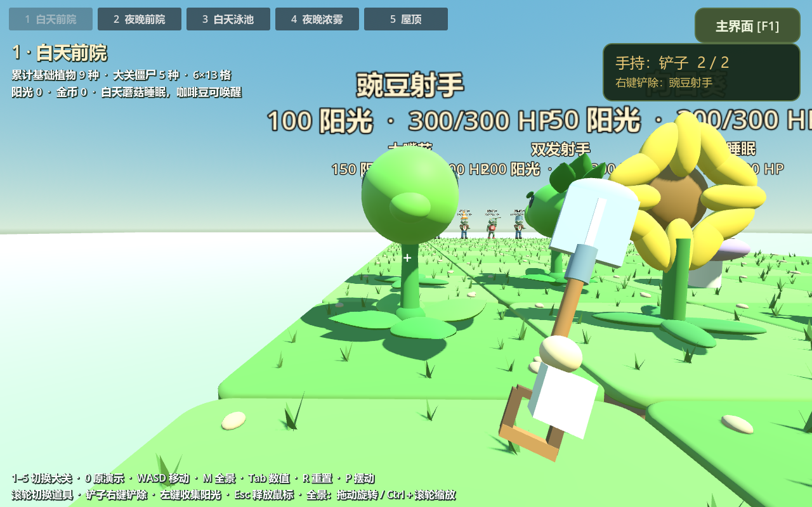

### 五个大关

| 数字键 | 场景 | 累计基础植物 | 僵尸类型 | 默认场地 |
| --- | --- | --- | --- | --- |
| 1 | [白天前院](scenes/stages/day.tscn) | 9 | 5 | 6×13 |
| 2 | [夜晚前院](scenes/stages/night.tscn) | 17 | 10 | 6×13 |
| 3 | [白天泳池](scenes/stages/pool.tscn) | 25 | 12 | 8×13，中央两行水道 |
| 4 | [夜晚浓雾](scenes/stages/fog.tscn) | 33 | 14 | 10×13，中央两行水道 |
| 5 | [屋顶](scenes/stages/roof.tscn) | 40 | 17 | 10×13，左侧坡面 |

展示截至该大关结束的全部已解锁基础植物，包括该大关第 10 小关的奖励；商店购买的升级植物不自动加入。植物在左侧第 2–5 列按列铺开，僵尸从右侧出生，多种僵尸可占用同一路径的不同格子。地面植物使用陆地行，睡莲、缠绕海草和海蘑菇在泳池水道中展示；没有泳池的大关用带“展示池”标签的小水池保留已解锁水生植物，其不参加战斗。泳池雪橇小队包含四名各自存活、受伤的成员。

浓雾名单包含砸罐子的舞王/伴舞及二周目的雪人，屋顶包含 5-10 的僵王机甲及其召唤名单中的读报、铁门和冰车。这些是同场展示的特殊关内容，雪人标签注明二周目；当前没有在场景内划分特殊小关或二周目进度。

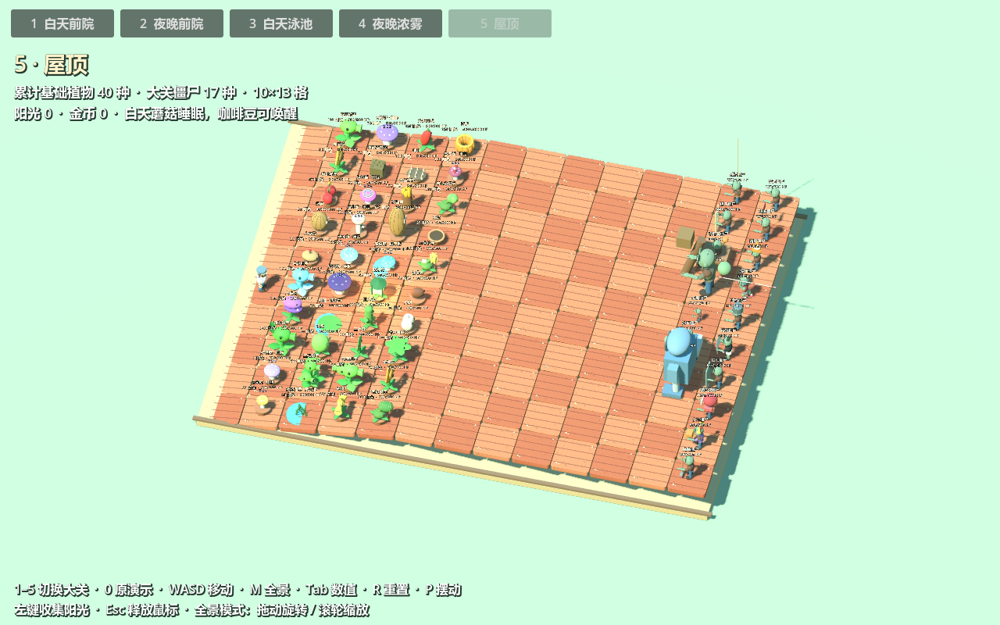

### 大关演示规则

各植物、僵尸都有区分模型、中文名称与实时生命标签，**Tab** 查看完整名单、植物阳光费用和僵尸本体/头甲/盾牌血量。植物费用用作信息展示；没有选卡、阳光扣费或种植冷却流程。

- 射手自动检测路径，双发连射、三线覆盖相邻路径、裂荚向前后射击、杨桃五向射击；喷菇短射程，大喷菇穿透。卷心菜、玉米、西瓜使用抛物线，玉米有黄油定身，西瓜有范围伤害。低处的水平弹体会被屋顶坡面截住。
- 向日葵与阳光菇产阳光，白天蘑菇睡眠，屋顶的咖啡豆自动寻找并唤醒睡眠蘑菇。夜晚与浓雾没有天降阳光；大关天空的中阳光默认 **25** 点，原演示仍为 **50** 点。
- 樱桃、土豆雷、倭瓜、辣椒、寒冰菇、毁灭菇和海草按目标条件自动触发；土豆雷需准备 15 秒。大嘴花吞食后消化 42 秒，面对巨型/车辆目标改为啃咬。火炬强化普通豌豆、解冻寒冰豌豆，磁力菇移除金属装备，三叶草吹走气球并清雾，路灯花清除周围雾团。
- 僵尸接近植物后啃食，普通啃食默认 **100 HP/秒**；坚果/南瓜 4000 HP、高坚果 8000 HP。撑杆、海豚和跳跳跨越普通植物，高坚果阻挡；铁门与梯子盾牌可被抛物线/穿透攻击绕过。气球飞行、潜水隐身、矿工掘地返向、舞王召伴舞、冰车压植物并留冰、小丑爆炸、蹦极偷植物、投石车投掷、巨人砸植物并扔小鬼均有演示行为。
- 死亡或使用后的植物默认 **8 秒**恢复展示，僵尸死亡默认 **1 秒**刷新；玩家手动铲除的植物保持移除。**R** 重建当前阵容、取消待刷新任务，并清理子弹、临时效果、尸体与资源。切换大关会完整释放旧场景，旧场景的刷新任务不会带到新场景。

演示场景使用 `plan.md` 的初始化生命、头甲/盾牌与主要伤害作为基础，速度换算到当前 3D 世界。自动触发、固定刷新、花盆装饰、水生展示池和简化僵王攻击用于演示；演示模式持续交战，没有胜负。冒险模式另有五十关流程、真实叠放、墓碑出怪、弹坑与僵王战斗，两个模式的生命周期互不干扰。

### 原演示（0 键）的一次游戏过程

1. **进入庭院**：启动后生成独立草坪格，放置五种射手、坚果、戴夫、房屋，以及普通、路障、铁桶、撑杆、读报五种僵尸。
2. **观察自动防守**：僵尸沿各自路径向植物方向缓慢前进；植物发现自己覆盖路径上的有效目标后开始攻击计时。
3. **体验不同植物组合**：双发和机枪提高同一路径的输出，三线覆盖相邻路径，寒冰降低僵尸的行走速度，坚果提供实体障碍并触发撑杆跳跃。
4. **观察受击与死亡**：豌豆命中产生伤害、闪白、击退和后仰；生命降到阈值时脱落盔甲或手臂，死亡时飞头并留下物理尸体。
5. **持续交战与探索**：死亡 1 秒后，该防线刷新满血同类型僵尸。玩家可以继续观察、按 Tab 查看战斗数据，或转身进出房屋。
6. **重置演示**：按 R 恢复初始交战状态，清除豌豆和遗留部件，取消待刷新计时，重置射手冷却、僵尸生命和戴夫位置。

0 键原演示中的僵尸不会啃食植物，也不会攻击戴夫；达到配置的最大行走距离后会停止前进。房屋目前提供可行走的探索空间，尚无商店、任务或房屋道具交互。下述旧射手、旧僵尸数值和近景操作均针对该演示。

### 原演示植物怎样攻击

有效目标必须同时满足：**仍然存活、属于陆地僵尸、已经着地、位于植物前方，并处在植物覆盖的路径中**。没有有效目标时，攻击计时恢复到完整间隔；重新出现目标后，再等待默认 1.5 秒开火。

| 植物 | 当前攻击规则 |
| --- | --- |
| 豌豆射手 | 向自己所在路径发射一颗普通豌豆 |
| 双发射手 | 从同一炮口连续发射两颗，颗间隔默认 0.18 秒；目标失效时取消剩余连射 |
| 机枪射手 | 依次使用四个炮管连续发射四颗，颗间隔默认 0.18 秒；目标失效时取消剩余连射 |
| 三线射手 | 自身与左右相邻路径中任意一路出现有效目标时，同时向三路齐射；边界处跳过草坪外的路径，覆盖内没有僵尸的路径仍会出弹 |
| 寒冰射手 | 发射一颗寒冰豌豆，默认伤害与普通豌豆相同，额外施加减速 |
| 坚果 | 当前只有模型和防御碰撞，不发射弹体，也没有生命值或被啃食逻辑；友方豌豆可以穿过 |

豌豆从实际炮口位置出发，保持水平飞行，不追踪目标。每颗默认造成 20 点伤害，只命中一次便消失，超过最大飞行距离后清理。三线射手的侧路豌豆在水平面内逐渐展开，默认前进 3.6 单位后对齐目标路径，只对对应路径的僵尸结算伤害。

双发和机枪每颗豌豆都触发共同的头部与茎后坐力；三线每轮齐射触发一次共同后坐力。植物根部与地面叶片保持固定，默认单次后仰 20°，0.28 秒恢复，叠加后仍不超过 30°。

### 原演示僵尸状态与物理效果

| 条件 | 当前行为 |
| --- | --- |
| 存活并行走 | 朝植物方向前进，默认基础速度 0.5 单位/秒，维持原防线路径 |
| 被豌豆命中 | 扣除伤害，全身闪白默认 0.5 秒，产生小幅击退和最多 30° 的视觉后仰 |
| 被寒冰豌豆命中 | 默认移速变为基础值的 50%，持续 10 秒；重复命中刷新时间，不叠加减速比例，闪白显示优先于冰蓝染色 |
| 读报僵尸生命 ≤200 | 报纸只脱落一次，停步发怒 1 秒，然后以 2 倍基础移速前进；默认从 0.5 变为 1.0 单位/秒，寒冰仍作用于加速后的移速 |
| 路障或铁桶僵尸生命 ≤200 | 盔甲只脱落一次，以独立刚体抛出、落地与滚动；总生命继续使用该实例剩余数值 |
| 任意僵尸生命 ≤100 | 随机脱落左手或右手及前臂，每只只掉一边 |
| 生命 ≤0 | 停止作为存活目标，头飞出，身体随机向前或向后倒地；伤害跨越多个阈值时，允许同一次命中触发多个部件脱落 |
| 死亡后 1 秒 | 对应防线底线刷新满血同类型实例，重置部件、减速与受击状态 |
| 遗留物达到寿命 | 尸体默认 5 秒后消失；头、断手、盔甲、长杆和报纸默认 10 秒后消失，刷新新僵尸不会提前清理它们 |

撑杆僵尸持杆时，会寻找同一路径前方最近的可跨越植物。默认靠近到 1.3 单位时准备 0.28 秒，再通过重力弹道跃过，默认跳跃高度为 1.85 单位，落点在植物后方约 1.1 单位；默认布局中首先遇到第 5 行第 8 列的坚果。飞行中释放长杆，落地后继续行走，每只僵尸最多撑杆跳一次。失去手臂也会导致脱杆，脱杆后无法再发起撑杆跳。

腾空的撑杆僵尸不会触发植物的陆地目标检测；已经发射的豌豆仍按实际碰撞结算伤害。寒冰影响行走速度，已经起跳的弹道不随减速重新计算。

### 原演示读报僵尸

读报僵尸默认拥有 **350** 点生命，在第 4 行第 9 列出生，面对三线射手。持报纸时以 **0.5 单位/秒** 行走；生命降至 **200 或以下**时，报纸成为独立物理部件并脱落，眼镜消失，眼睛变为粉红色。它停步摇头发怒 **1 秒**，期间仍可受伤，然后以 **1.0 单位/秒**（基础速度的 **2 倍**）继续前进。再次受击不会重复掉报纸，也不会重新开始停步计时。

寒冰减速与发怒倍率相乘，默认发怒且减速时为 **0.5 单位/秒**；减速到期后仍保持发怒速度。伤害直接致死时照常掉落报纸和死亡部件，停止发怒；死亡后 1 秒刷新为满血、持报纸的新实例。R 恢复报纸、眼镜、普通眼睛与原始速度，清除发怒计时和所有掉落物。报纸默认脱落 10 秒后清理。

| 持报纸 | 报纸脱落后发怒 |
| --- | --- |
|  |  |

当前僵尸仍不啃食植物，读报僵尸加速后可能走过射手；达到配置的最大行走距离时停止。

## 演示模式操作方式

| 按键 / 操作 | 功能 |
| --- | --- |
| F1 / 主界面按钮 | 退出演示并返回主界面 |
| 1 / 2 / 3 / 4 / 5 | 白天 / 夜晚 / 泳池 / 浓雾 / 屋顶；支持主键盘与数字小键盘 |
| 0 | 进入原五路交战演示；在其中仍可按 1–5 返回大关 |
| WASD / 方向键 | 在戴夫视角中移动 |
| 移动鼠标 | 戴夫视角直接转向，上下调整镜头 |
| Esc | 关闭已打开的数值侧栏；侧栏关闭时释放鼠标 |
| 左键点击阳光 | 收集并增加对应点数；大关中阳光默认 25，原演示默认 50；鼠标锁定时用中央准星瞄准 |
| 左键点击场景空白处 | 在戴夫视角中重新锁定鼠标 |
| Tab | 展开或收起右侧战斗数值栏，查看实时血量与战斗参数 |
| M | 大关中切换戴夫视角与全景；原演示中切换植物模型视角 |
| Z / X / V / B / N | 原演示专用：查看普通、路障、铁桶、撑杆、读报僵尸 |
| 滚轮向上 / 向下 | 在空手与铲子之间循环切换 |
| 铲子 + 右键 | 戴夫视角近距离瞄准铲除；全景/模型视角直接右键植物 |
| 模型视角中左键拖动 / Ctrl＋滚轮 | 旋转模型视角 / 缩放 |
| R | 重置当前场景的交战、位置、生命与资源；原演示也有“重新开始”按钮 |
| P / 原演示“暂停摆动”按钮 | 大关中 P 暂停或恢复待机摆动；原演示使用按钮 |
| 靠近房门 | 自动开门，支持从室内和室外进出 |

打开数值侧栏会释放鼠标并暂停戴夫的移动和转向，场上的交战继续。窗口失去焦点时会释放鼠标。暂停植物待机摆动时，射击和开火后坐力仍然生效。

白天每 10 秒从天空掉落一个中阳光，缓慢垂直降到随机空格，落地固定。飞行中或落地后均可左键收集，初始余额为 **0**。按 Esc 释放鼠标后可直接点击，全景/模型视角同样支持收集。未收集的阳光落地 20 秒后消失，最后 3 秒淡出；R 清空阳光与余额。通用参数在 `sun`，大关天空点数在 `stages.sun_value`。

## 原演示的已有玩法与布局

- **独立实体**：植物、僵尸、戴夫、房屋和每格草坪分别拥有自己的场景或节点，可以单独复用。
- **自动射击**：普通豌豆、双发、机枪、三线和寒冰射手根据各自覆盖路径检测陆地目标；豌豆水平飞行，命中后造成一次伤害并消失。
- **植物后坐力**：头部、炮口与茎绕根部共同后仰并恢复，总幅度不超过 30°。
- **僵尸受击与死亡**：闪白、击退、后仰、盔甲脱落、随机断手、飞头与前后倒地；脱落部件通过刚体模拟抛物线、碰撞、反弹和翻滚。
- **寒冰减速**：命中后降低移速，重复命中刷新持续时间；冰蓝染色与受击闪白分别处理。
- **撑杆跳跃**：持杆僵尸接近同一路径前方第一株植物时跳跃一次，越过植物并释放长杆。
- **读报发怒**：350 生命，≤200 时掉报纸，停步发怒 1 秒后以 2 倍基础移速前进；支持寒冰、部件物理、独立刷新和重置。
- **死亡刷新**：僵尸死亡后在对应防线底线刷新同类型的新实例，旧尸体与掉落部件按各自寿命清理。
- **房屋探索**：门廊、真实门洞、自动门、室内家具、墙体碰撞和连续的可行走地面。
- **集中配置**：战斗、物理、草坪、模型部件、戴夫操作、相机、灯光、房屋和界面参数均可通过 JSON 调整。
- **天降阳光**：每 10 秒随机落到空草坪格，落地固定；点击收集 50 点，左上角显示累计值。

### 原演示默认场地

草坪为 **5 行 × 9 列**，相邻格中心间距为 **2.4 世界单位**。行沿 Z 轴排列，列沿 X 轴排列；戴夫面向植物时，第 1 行在左侧，第 5 行在右侧。下表中的行、列从 1 开始。

| 路径 | 第 2 列植物 | 攻击特点 | 第 9 列僵尸 / 初始生命 |
| --- | --- | --- | --- |
| 第 1 行 | 机枪射手 | 每轮四连射 | 铁桶僵尸 / 1370 |
| 第 2 行 | 双发射手 | 每轮两连射 | 路障僵尸 / 570 |
| 第 3 行 | 豌豆射手 | 每轮一颗豌豆 | 普通僵尸 / 200 |
| 第 4 行 | 三线射手 | 同时覆盖第 3、4、5 行 | 读报僵尸 / 350 |
| 第 5 行 | 寒冰射手 | 豌豆附带限时减速 | 撑杆僵尸 / 500 |

坚果位于第 5 行第 8 列，用于演示撑杆跳跃。戴夫初始位于第 3 行第 1 列。房屋在植物一侧的草坪后方，正门朝向草坪。

### 戴夫的房屋

房屋拥有红瓦坡屋顶、烟囱、窗户和门廊，室内有沙发、桌子、书架和照明。戴夫靠近正门时，门会自动向外打开；离开触发区域后延迟关闭。使用同一个腰部相机和 WASD 控制器进出，移动边界包含房屋及周围地面。

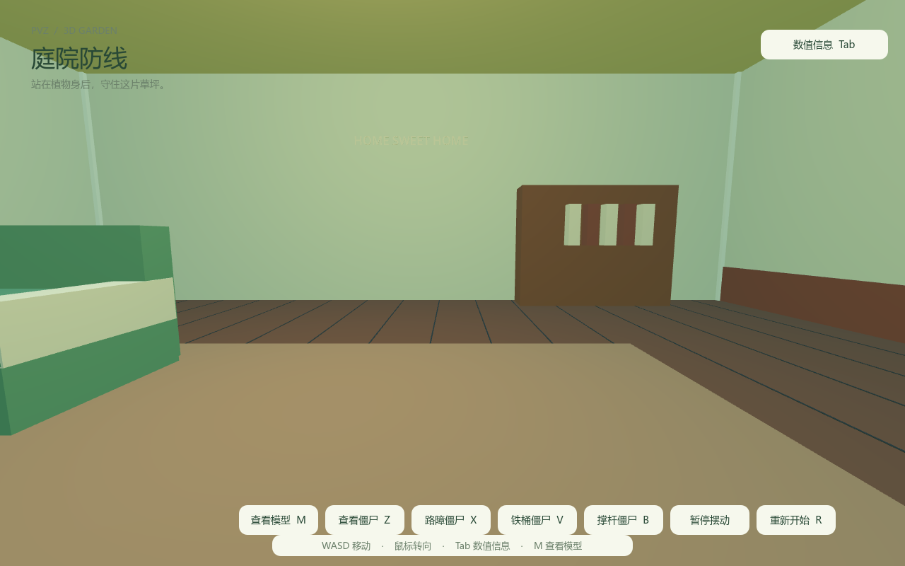

房屋造型参考[原版游戏住宅图库](https://plantsvszombies.fandom.com/wiki/Player%27s_House/Gallery)。模型使用项目内的几何体与程序生成方式搭建。

## 调整数值

编辑 [config/game_config.json](config/game_config.json)，保存后停止游戏并重新按 **F5** 启动。完整字段、单位、范围与示例见 [配置说明](config/README.md)。

[GameConfig 自动加载单例](scripts/game_config.gd) 在启动时从 `res://config/game_config.json` 读取一次。后续生成的僵尸、豌豆和掉落物共用这份配置，**R 重置使用本次启动的快照**。配置路径相对于项目根目录，克隆到其他目录后仍然有效。

| 常用调整 | 配置字段 | 内置默认值 |
| --- | --- | --- |
| 冒险初始阳光 / 1-1 初始阳光 | `adventure.initial_sun` / `initial_sun_tutorial` | 50 / 150 |
| 冒险卡牌冷却 | `adventure.card_cooldowns.类型` | 7.5 / 7.5 / 50 / 30 秒 |
| 冒险樱桃引爆 / 割草机速度 | `adventure.cherry_fuse` / `mower_speed` | 1.2 秒 / 8 单位每秒 |
| 演示铲子作用距离 | `demo_tools.shovel_reach` | 戴夫视角 4.8 世界单位 |
| 默认进入的大关 | `stages.start_stage` | 1 |
| 大关植物列数 / 最少行数 / 总列数 | `stages.plant_columns` / `minimum_rows` / `board_columns` | 4 / 6 / 13 |
| 大关植物恢复展示延迟 | `stages.plant_respawn_delay` | 8 秒 |
| 大关某植物生命 / 伤害 | `stages.plants.类型.maximum_health` / `damage` | 见 JSON 与 plan.md |
| 大关某僵尸本体 / 头甲 / 盾牌 | `stages.zombies.类型.body_health` / `helmet_health` / `shield_health` | 见 JSON 与 plan.md |
| 豌豆伤害 | `plants.common.pea_damage` | 20 |
| 每轮攻击间隔 | `plants.common.shot_interval` | 1.5 秒 |
| 豌豆速度 | `plants.common.pea_speed` | 10 单位/秒 |
| 双发 / 机枪每轮颗数 | `plants.types.repeater.burst_size` / `plants.types.gatling_pea.burst_size` | 2 / 4 |
| 连射颗间隔 | 对应类型的 `burst_spacing` | 0.18 秒 |
| 寒冰移速倍率 / 持续时间 | `plants.types.snow_pea.slow_multiplier` / `slow_duration` | 0.5 / 10 秒 |
| 僵尸移动速度 | `zombies.common.walk_speed` | 0.5 单位/秒 |
| 击退初速度 / 衰减 | `zombies.common.knockback_speed` / `knockback_deceleration` | 1.4 / 10 |
| 受击闪白 | `zombies.common.flash_duration` | 0.5 秒 |
| 死后刷新延迟 | `respawn.respawn_delay` | 1 秒 |
| 草坪尺寸 | `lawn.rows` / `columns` / `cell_size` | 5 / 9 / 2.4 |
| 腰部相机高度 | `dave.waist_height` | 0.94 单位 |
| 模型整体大小 | `models.类型.scale` | 1 倍 |
| 房屋尺寸 / 后退距离 | `house.width` / `depth` / `front_gap` | 9.6 / 7.6 / 1.8 单位 |

`adventure` 配置冒险经济、卡牌冷却与波次时间；冒险复用 `stages.plants/zombies` 的生命、伤害、费用与移速倍率。`stages` 同时管理演示的数值与自动布局；旧 `plants`、`zombies`、`placements` 管理 0 键原演示。各模式共用格距、豌豆速度、受击与物理配置。公共参数与类型参数合并后应用，类型同名字段优先；省略字段使用[内置默认值](scripts/game_config_defaults.gd)。

文件缺失或 JSON 格式错误时整份回退；单个字段无效时仅该字段回退并输出字段路径和原因。草坪尺寸与放置位置冲突时，布局整体回退到默认值。模型调整会同步主要部件、炮口、碰撞体及撑杆握持和掉落位置，物理实体根节点保持单位缩放。

默认击退在 60 Hz、暂停行走且无遮挡时，单次位移约 **0.11 单位**。击退距离由初速度和衰减共同决定；植物后坐力和僵尸后仰均受 **30°** 上限约束。尸体默认 5 秒后消失，飞头、断手、盔甲与长杆默认 10 秒后消失。

## 项目结构

```text
PVZ_3d/
├── project.godot          # Godot 项目入口、主场景与自动加载设置
├── assets/               # 项目图标与原创基础网格
├── config/               # 游戏数值 JSON 与中文配置说明
├── scenes/
│   ├── game.tscn         # 主界面、模式导航与项目入口
│   ├── menu_backdrop.tscn # 主界面的实时 3D 庭院
│   ├── adventure/        # 冒险 1-1～2-10，共用 board.tscn
│   ├── adventure.tscn    # 演示模式、数字键与场景切换
│   ├── stages/           # 白天、夜晚、泳池、浓雾、屋顶
│   ├── main.tscn         # 0 键原演示
│   ├── characters/       # 戴夫、人物碰撞体与腰部相机
│   ├── enemies/          # 普通、路障、铁桶、撑杆、读报僵尸
│   ├── environment/      # 戴夫房屋
│   ├── plants/           # 五种射手与坚果
│   ├── projectiles/      # 普通豌豆与寒冰豌豆
│   ├── pickups/          # 中阳光实体
│   └── terrain/          # 单格草坪与草坪网格
├── scripts/              # 战斗、刷新、物理、配置、模型、操作与界面逻辑
├── tests/                # 24 项 Godot 回归测试
├── tools/                # Python 场景生成器与配置读取工具
├── docs/                 # 详细实现说明与实机截图
└── README.md             # 项目概览
```

主场景将 `House`、`LawnGrid`、`Plants`、`Characters`、`Enemies`、`Projectiles`、`Debris` 和 `SunSystem` 分开管理。格子查询与种植、刷新、阳光落点共用 `LawnGrid` 的坐标转换。详细节点结构、交战规则、物理效果和测试覆盖见 [场景、交战与验证说明](docs/implementation.md)。

## 后续开发入口

| 要开发或调整的内容 | 主要入口 | 现有职责 |
| --- | --- | --- |
| 主界面、选关与模式导航 | [game_app.gd](scripts/game_app.gd)、[game_ui.gd](scripts/game_ui.gd) | 主菜单、演示入口、任意选关、模式退出与重试 |
| 冒险关卡与种植交战 | [adventure_board.gd](scripts/adventure_board.gd)、[adventure_levels.gd](scripts/adventure_levels.gd) | 第一人称、暂停选植物、20 关供应/波次、墓碑/弹坑、库存、经济与胜负 |
| 冒险特殊战斗 | [adventure_bowling_nut.gd](scripts/adventure_bowling_nut.gd)、[adventure_zombie.gd](scripts/adventure_zombie.gd) | 滚动坚果、爆炸、魅惑双方战斗、四方向补召与墓碑出土 |
| 右手与背部道具模型 | [dave_hand.gd](scripts/dave_hand.gd) | 冒险与演示共用右手、缩小植物、持铲与背部收铲 |
| 冒险植物、割草机与进度 | [adventure_plant.gd](scripts/adventure_plant.gd)、[adventure_mower.gd](scripts/adventure_mower.gd)、[adventure_progress.gd](scripts/adventure_progress.gd) | 樱桃引信、一次扫场、逐关完成记录与本地存档 |
| 大关名单与累计解锁 | [stage_catalog.gd](scripts/stage_catalog.gd) | 五个大关的基础植物、普通与特殊关僵尸名单 |
| 数字键、按钮与场景切换 | [stage_switcher.gd](scripts/stage_switcher.gd) | 1–5 切换、0 原演示、退出清理 |
| 大关自动布局、刷新与界面 | [stage_demo.gd](scripts/stage_demo.gd)、[stage_lawn.gd](scripts/stage_lawn.gd) | 扩大格子、水陆分行、坡面、昼夜/浓雾、重置与侧栏 |
| 大关植物、僵尸与弹体 | [stage_plant.gd](scripts/stage_plant.gd)、[stage_zombie.gd](scripts/stage_zombie.gd)、[stage_projectile.gd](scripts/stage_projectile.gd) | 新大关自动防守、啃食、装备分层与演示能力 |
| 大关程序模型 | [stage_models.gd](scripts/stage_models.gd) | 复用已有模型，补齐不同植物/僵尸的特征 |
| 射手目标检测、计时和共同后坐力 | [peashooter.gd](scripts/peashooter.gd) | 豌豆类植物公共逻辑；双发、机枪、三线、寒冰通过子类扩展 |
| 弹体飞行、命中和减速施加 | [pea_projectile.gd](scripts/pea_projectile.gd) | 水平弹道、快速移动的扫掠检测、路径过滤与一次性伤害 |
| 僵尸生命、行走、减速、受击和部件阈值 | [zombie.gd](scripts/zombie.gd) | 普通、路障、铁桶共用的基础行为，也是撑杆与读报僵尸的父类 |
| 读报阈值、停步发怒与加速 | [newspaper_zombie.gd](scripts/newspaper_zombie.gd) | 一次性掉报纸、发怒计时、粉红眼睛与寒冰叠加 |
| 撑杆目标、准备、起跳、脱杆和落地 | [pole_vaulting_zombie.gd](scripts/pole_vaulting_zombie.gd) | 一次跳跃状态与持杆姿势 |
| 部件物理与寿命 | [zombie_debris.gd](scripts/zombie_debris.gd) | 独立刚体、地面碰撞、摩擦、反弹和清理 |
| 原演示布局、刷新与界面 | [demo.gd](scripts/demo.gd) | 0 键演示的组合、信号连接和五条刷新计时 |
| 天降阳光、收集与资源余额 | [sun_system.gd](scripts/sun_system.gd)、[sun_pickup.gd](scripts/sun_pickup.gd) | 掉落计时、空格落点、稳定落地、点击与一次性结算 |
| 格子坐标、种植位置与草坪生成 | [lawn_grid.gd](scripts/lawn_grid.gd) | 统一行列转换与独立格子管理 |
| 戴夫移动与腰部相机 | [crazy_dave.gd](scripts/crazy_dave.gd) | 输入、鼠标锁定、移动边界与视角切换 |
| 演示手持道具与铲除 | [demo_tools.gd](scripts/demo_tools.gd) | 滚轮循环、手持模型、目标射线、范围/遮挡校验与右键铲除 |
| 房屋结构、自动门与探索范围 | [dave_house.gd](scripts/dave_house.gd) | 配置驱动的模型、实体碰撞和室内外通行 |
| 数值、模型配置和字段校验 | [game_config.gd](scripts/game_config.gd)、[game_config_defaults.gd](scripts/game_config_defaults.gd) | 启动快照、类型合并、资源复制、应用与容错 |

扩展功能时保持以下约定，便于新旧玩法共同运行：

- **同步更新日志**：每次修改游戏功能、玩法、数值、操作、场景、模型、界面、配置或修复缺陷，都在同一批变更中更新 [CHANGELOG.md](CHANGELOG.md)。日常改动先记录到“未发布”区，涉及玩法或配置时同步更新相关说明。
- **统一坐标**：JSON 的行、列从 1 开始，脚本的 `cell_to_world(row, column)` 和 `get_tile(row, column)` 从 0 开始；格子坐标向量为 `(column, row)`。一条防线对应固定行，僵尸沿列方向推进。
- **配置先应用**：初始化生命、攻击计时和记录初始姿势前应用配置；数值变更集中到 JSON。新增配置字段同步更新内置默认值、验证规则和中文说明。
- **实例独立**：每个实体使用自己的模型资源副本，调整一个实例不会影响其他实例；物理根节点使用单位缩放。
- **生命周期分开**：活体僵尸在 `Enemies`，弹体在 `Projectiles`，遗留部件在 `Debris`；新实例刷新、尸体清理和 R 重置各自处理。
- **事件连接**：植物通过 `shot_fired`，僵尸通过 `health_changed`、`damaged` 和 `defeated` 提供事件。新增统计、音效或进度逻辑时可沿用这些信号。
- **新增类型完整接入**：增加对应场景和脚本，在配置中注册类型、模型及放置参数，并在 `demo.gd` 接入战斗、界面和需要的刷新逻辑；加入与该行为对应的验证。
- **重置覆盖状态**：新功能的待发射弹体、冷却、待刷新计时、临时效果和物理遗留物，应明确在 R 重置时如何处理。

## 验证

[tests](tests) 包含 **24 项回归测试**，使用实际的场景、弹体碰撞、角色移动和刚体物理进行验证。测试注入独立默认配置，配置集成测试使用临时文件；冒险测试不改写真实存档，也不修改用户 JSON。

| 验证内容 | 测试入口 |
| --- | --- |
| 主菜单真实点击、全关开放/跳关、种植扣费、真实阳光点击、暂停、樱桃、啃食、割草机、逐关存档与旧档迁移、模式清理 | [adventure_test.gd](tests/adventure_test.gd) |
| 第一人称、右键暂停选植物、真实物理冻结、右手持苗、透明预览、左键种植/铲除、收铲、取消与退出清理 | [adventure_hand_test.gd](tests/adventure_hand_test.gd) |
| 使用实际阳光、费用、冷却与战斗连续通关 1-1～1-4 | [adventure_playthrough_test.gd](tests/adventure_playthrough_test.gd) |
| 20 关场景/供应/敌人、坚果实际命中、传送带库存与暂停、夜晚经济、墓碑、蘑菇能力、木锤输入、旧存档与图鉴 | [adventure_expansion_test.gd](tests/adventure_expansion_test.gd) |
| 接续前四关进度，使用实际阳光/冷却/库存/木锤与战斗连续通关 1-5～2-10 | [adventure_expansion_playthrough_test.gd](tests/adventure_expansion_playthrough_test.gd) |
| 后三十关、真实叠放/铲除/啃食、坡面射线、冰道/雪橇、缩小弹体、浓雾/闪电、三组罐子、僵王护甲/抛射/冰火球、旧存档 | [adventure_campaign_test.gd](tests/adventure_campaign_test.gd) |
| 接续 2-10，使用实际资源/冷却/供应/砸罐和战斗连续通关 3-1～5-10 | [adventure_campaign_playthrough_test.gd](tests/adventure_campaign_playthrough_test.gd) |
| 五个大关累计名单、水陆放置、昼夜、键盘切换、旧场景清理、数值分层与重置 | [stages_test.gd](tests/stages_test.gd) |
| 各大关 90 秒自动交战、召唤/弹体数量边界、重置 | [stages_stability_test.gd](tests/stages_stability_test.gd) |
| 真实滚轮/右键铲除、距离与遮挡、停止攻击、取消补回、R 恢复、视角/模式清理 | [demo_tools_test.gd](tests/demo_tools_test.gd) |
| 天降阳光间隔、落地稳定、点击结算、遮挡与重置 | [sun_test.gd](tests/sun_test.gd) |
| 配置容错、类型覆盖、模型与碰撞同步、R 保留快照 | [config_test.gd](tests/config_test.gd) |
| 射击、命中、闪白、击退与后仰 | [combat_test.gd](tests/combat_test.gd) |
| 各类型死亡后的底线刷新 | [respawn_test.gd](tests/respawn_test.gd) |
| 双发、三线、机枪与寒冰行为 | [repeater_test.gd](tests/repeater_test.gd)、[threepeater_test.gd](tests/threepeater_test.gd)、[gatling_pea_test.gd](tests/gatling_pea_test.gd)、[snow_pea_test.gd](tests/snow_pea_test.gd) |
| 铁桶、断肢与掉落物物理和清理 | [buckethead_test.gd](tests/buckethead_test.gd)、[zombie_parts_test.gd](tests/zombie_parts_test.gd) |
| 读报掉落阈值、1 秒停步、加速、寒冰与生命周期 | [newspaper_test.gd](tests/newspaper_test.gd) |
| 撑杆跃过坚果、脱杆与落地 | [pole_vaulting_test.gd](tests/pole_vaulting_test.gd) |
| 头部与茎的共同后坐力 | [plant_recoil_test.gd](tests/plant_recoil_test.gd) |
| 自动门、实际进出房屋与墙体阻挡 | [house_test.gd](tests/house_test.gd) |

在项目根目录运行以下命令。示例假设 Godot 已加入 PATH，可以通过 `godot` 调用；也可替换成 Godot 可执行文件的完整路径，Windows 建议使用控制台版本查看输出。

```powershell
# 运行配置集成测试
godot --headless --path . --fixed-fps 60 --script res://tests/config_test.gd

# 依次运行全部回归测试，失败时停止
Get-ChildItem .\tests\*_test.gd | ForEach-Object {
    & godot --headless --path . --fixed-fps 60 --script ("res://tests/" + $_.Name)
    if ($LASTEXITCODE -ne 0) { throw ("测试失败：" + $_.Name) }
}
```

## 场景生成工具

[tools/build_assets.py](tools/build_assets.py) 使用 Python 读取同一套配置，生成基础网格及 Godot 场景。已有资源随仓库保存，日常运行和修改 JSON 后重启游戏即可。

```powershell
python tools/build_assets.py --help
python tools/build_assets.py --house-only
python tools/build_assets.py --newspaper-only
```

生成器支持草坪布局、戴夫、各植物与僵尸、坚果、房屋等局部重建，参数见 `--help`。生成操作会覆盖对应场景及主场景；手动调整过模型时，请先保存版本。模型资源按基准几何生成，运行时再应用配置，避免重复缩放。

[tools/build_stages.py](tools/build_stages.py) 根据 `stage_catalog.gd` 重新生成五个大关场景，场地大小与实际放置在启动时读取 `stages` 配置。模型由 `stage_models.gd` 构建，修改名单后执行 `python tools/build_stages.py`。实机截图工具为 [capture_stages.gd](tools/capture_stages.gd)，使用 Godot 非 headless 模式运行，输出到 `artifacts/`。

[capture_adventure.gd](tools/capture_adventure.gd) 渲染主界面、选关、前四关、暂停选择、右手持苗与落点预览、持铲、背部收铲、暂停与胜利界面，使用内存进度和冻结的截图布置，不修改真实冒险存档。命令行 `godot --path . -- --mode=demo` 可直接开演示，`-- --level=1` 可直接进入 1-1；命令行与菜单均可任意选关，胜利只记录实际完成的关卡。

[capture_demo_tools.gd](tools/capture_demo_tools.gd) 通过实际滚轮/右键输入，渲染手持铲子、铲除反馈、全景与 0 键原演示，输出到 `artifacts/`；同样使用 Godot 非 headless 模式运行。

[capture_expansion.gd](tools/capture_expansion.gd) 渲染白天/夜晚选关、保龄球、夜晚蘑菇与选择面板、木锤、两种传送带、图鉴以及 960×600 配置的界面。[capture_campaign.gd](tools/capture_campaign.gd) 渲染后三个大关选关、泳池、浓雾、罐子、屋顶叠放、完整卡牌、僵王和小窗口五个选关标签。命令行 `godot --path . -- --level=5-10` 可直接进入关卡，也接受连续编号 1～50。

## 后续完善

演示继续使用固定布局，冒险已具备首轮五十关的常规与特殊流程。下面是尚未实现的扩展方向；具体玩法与数值在开发对应功能时确定。

| 建议阶段 | 功能 | 与当前实现的衔接 |
| --- | --- | --- |
| 1 | 完善原版特性与模型动画 | 细化动画、随机规则、传送带移动效果和僵王演出 |
| 2 | 二周目与更多挑战 | 加入戴夫预选、二周目雪人和冒险之外的小游戏 |
| 3 | 开局选卡、商店升级与更多植物 | 在累计可用植物上增加槽位限制、购物及升级关系 |
| 4 | 商店、禅境花园与长期经济 | 将剧情钥匙/卷饼/浇水壶与可使用的页面和持久金币连接 |
| 5 | 完整教学、奖励动画与音效 | 继续细化首次种植指引、对白、奖励呈现与游戏反馈 |
| 6 | 更多存档数据与房屋交互 | 在已完成关卡记录上增加设置、其他进度及房屋道具交互 |

## 保存项目版本

使用 GitHub Desktop 时，添加的本地仓库根目录应与 `project.godot` 位于同一层。每次完成修改，在 Godot 中保存并测试，再在 GitHub Desktop 中填写修改说明、**Commit**，最后 **Push origin** 上传。

游戏更新与对应的 `CHANGELOG.md` 条目一起提交；发布版本时再将“未发布”区整理为指定版本的记录。

提交游戏源文件、场景、配置、模型资源、文档及 `.uid` 文件。[.gitignore](.gitignore) 已排除 `.godot/` 缓存和 `artifacts/` 本地测试产物，但保留 `artifacts/.gdignore` 隔离文件；本页截图保存在 `docs/images/`，会随文档提交。`docs/.gdignore` 和 `artifacts/.gdignore` 分别让 Godot 跳过文档、临时工具与测试产物的资源扫描，防止把 Blender 自带的 GLSL 等文件作为游戏资源导入。`.gitignore` 本身不会阻止 Godot 扫描。已遇到这些工具文件的加载错误时，确认关闭错误弹窗后重新打开项目，让编辑器重新扫描目录。
