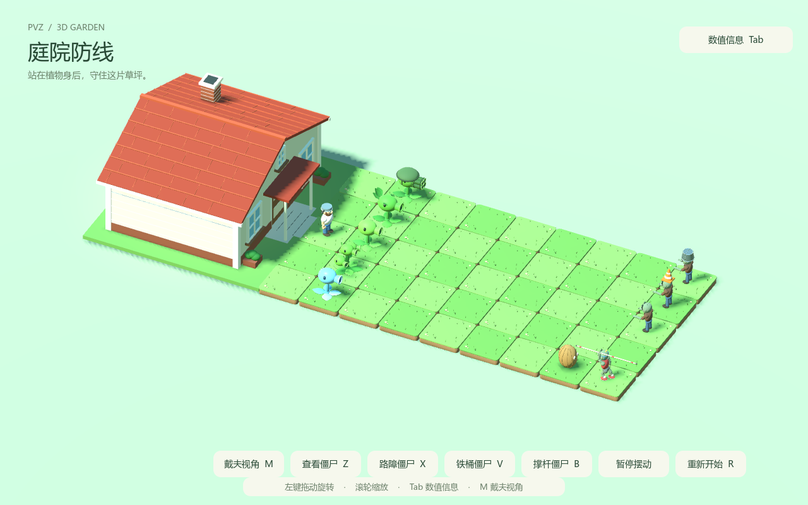

# PVZ 3D · 疯狂戴夫的庭院

使用 Godot 制作的《植物大战僵尸》3D 玩法原型。玩家从疯狂戴夫的腰部视角探索庭院，观察植物自动射击、僵尸受击与撑杆跳跃，也可以走进植物后方的房屋。

当前已实现五种射手、坚果、四种僵尸、独立草坪格、自动战斗、物理掉落、房屋探索和统一 JSON 配置。项目仍在持续开发。



## 快速开始

项目已使用 **Godot 4.7.2** 验证，渲染方式为 **Compatibility**。建议使用同一版本打开；运行游戏只需 Godot，Python 用于可选的场景生成工具。

1. 克隆本仓库，或下载仓库 ZIP 后解压。使用 Git 时可执行：

   ```powershell
   git clone https://github.com/Florenkin/PVZ_3d.git
   ```

2. 在 Godot 项目管理器中点击“导入”，选择仓库根目录的 [project.godot](project.godot)。
3. 等待首次资源导入完成，按 **F5** 运行项目，主场景为 [scenes/main.tscn](scenes/main.tscn)。
4. 默认进入戴夫视角，用 WASD 移动，移动鼠标直接转向。转身走到房门前即可进入房屋。

游戏启动后，植物会自行检测防线上的僵尸并射击；四条僵尸防线独立处理死亡与刷新。

## 游戏内容与玩法

玩家扮演疯狂戴夫，从植物阵线后方以腰部相机视角观察庭院。当前版本用于体验和验证 3D 防线交战：植物、坚果和僵尸在启动时按配置放置，玩家可以自由移动、查看模型、观察战斗和探索房屋。戴夫当前没有生命值、主动攻击或种植操作。

### 一次游戏的过程

1. **进入庭院**：启动后生成独立草坪格，放置五种射手、坚果、戴夫、房屋，以及普通、路障、铁桶、撑杆四种僵尸。
2. **观察自动防守**：僵尸沿各自路径向植物方向缓慢前进；植物发现自己覆盖路径上的有效目标后开始攻击计时。
3. **体验不同植物组合**：双发和机枪提高同一路径的输出，三线覆盖相邻路径，寒冰降低僵尸的行走速度，坚果提供实体障碍并触发撑杆跳跃。
4. **观察受击与死亡**：豌豆命中产生伤害、闪白、击退和后仰；生命降到阈值时脱落盔甲或手臂，死亡时飞头并留下物理尸体。
5. **持续交战与探索**：死亡 1 秒后，该防线刷新满血同类型僵尸。玩家可以继续观察、按 Tab 查看战斗数据，或转身进出房屋。
6. **重置演示**：按 R 恢复初始交战状态，清除豌豆和遗留部件，取消待刷新计时，重置射手冷却、僵尸生命和戴夫位置。

当前没有波次结束、胜利或失败结算。僵尸不会啃食植物，也不会攻击戴夫；达到配置的最大行走距离后会停止前进。房屋目前提供可行走的探索空间，尚无商店、任务或道具交互。

### 植物怎样攻击

有效目标必须同时满足：**仍然存活、属于陆地僵尸、已经着地、位于植物前方，并处在植物覆盖的路径中**。没有有效目标时，攻击计时恢复到完整间隔；重新出现目标后，再等待默认 1.5 秒开火。

| 植物 | 当前攻击规则 |
| --- | --- |
| 豌豆射手 | 向自己所在路径发射一颗普通豌豆 |
| 双发射手 | 从同一炮口连续发射两颗，颗间隔默认 0.18 秒；目标失效时取消剩余连射 |
| 机枪射手 | 依次使用四个炮管连续发射四颗，颗间隔默认 0.18 秒；目标失效时取消剩余连射 |
| 三线射手 | 自身与左右相邻路径中任意一路出现有效目标时，同时向三路齐射；边界处跳过草坪外的路径，覆盖内没有僵尸的路径仍会出弹 |
| 寒冰射手 | 发射一颗寒冰豌豆，默认伤害与普通豌豆相同，额外施加减速 |
| 坚果 | 当前只有模型和防御碰撞，不发射弹体，也没有生命值或被啃食逻辑；友方豌豆可以穿过 |

豌豆从实际炮口位置出发，保持水平飞行，不追踪目标。每颗默认造成 20 点伤害，只命中一次便消失，超过最大飞行距离后清理。三线射手的侧路豌豆在水平面内逐渐展开，默认前进 3.6 单位后对齐目标路径，只对对应路径的僵尸结算伤害。

双发和机枪每颗豌豆都触发共同的头部与茎后坐力；三线每轮齐射触发一次共同后坐力。植物根部与地面叶片保持固定，默认单次后仰 20°，0.28 秒恢复，叠加后仍不超过 30°。

### 僵尸状态与物理效果

| 条件 | 当前行为 |
| --- | --- |
| 存活并行走 | 朝植物方向前进，默认基础速度 0.5 单位/秒，维持原防线路径 |
| 被豌豆命中 | 扣除伤害，全身闪白默认 0.5 秒，产生小幅击退和最多 30° 的视觉后仰 |
| 被寒冰豌豆命中 | 默认移速变为基础值的 50%，持续 10 秒；重复命中刷新时间，不叠加减速比例，闪白显示优先于冰蓝染色 |
| 路障或铁桶僵尸生命 ≤200 | 盔甲只脱落一次，以独立刚体抛出、落地与滚动；总生命继续使用该实例剩余数值 |
| 任意僵尸生命 ≤100 | 随机脱落左手或右手及前臂，每只只掉一边 |
| 生命 ≤0 | 停止作为存活目标，头飞出，身体随机向前或向后倒地；伤害跨越多个阈值时，允许同一次命中触发多个部件脱落 |
| 死亡后 1 秒 | 对应防线底线刷新满血同类型实例，重置部件、减速与受击状态 |
| 遗留物达到寿命 | 尸体默认 5 秒后消失；头、断手、盔甲和长杆默认 10 秒后消失，刷新新僵尸不会提前清理它们 |

撑杆僵尸持杆时，会寻找同一路径前方最近的可跨越植物。默认靠近到 1.3 单位时准备 0.28 秒，再通过重力弹道跃过，默认跳跃高度为 1.85 单位，落点在植物后方约 1.1 单位；默认布局中首先遇到第 5 行第 8 列的坚果。飞行中释放长杆，落地后继续行走，每只僵尸最多撑杆跳一次。失去手臂也会导致脱杆，脱杆后无法再发起撑杆跳。

腾空的撑杆僵尸不会触发植物的陆地目标检测；已经发射的豌豆仍按实际碰撞结算伤害。寒冰影响行走速度，已经起跳的弹道不随减速重新计算。

## 操作方式

| 按键 / 操作 | 功能 |
| --- | --- |
| WASD / 方向键 | 在戴夫视角中移动 |
| 移动鼠标 | 戴夫视角直接转向，上下调整镜头 |
| Esc | 关闭已打开的数值侧栏；侧栏关闭时释放鼠标 |
| 左键点击场景 | 在戴夫视角中重新锁定鼠标 |
| Tab | 展开或收起右侧战斗数值栏，查看实时血量与战斗参数 |
| M | 切换戴夫视角与植物模型查看视角 |
| Z / X / V / B | 查看普通、路障、铁桶、撑杆僵尸；再次按相同键返回戴夫视角 |
| 模型视角中左键拖动 / 滚轮 | 旋转模型视角 / 缩放 |
| R / “重新开始”按钮 | 重置交战、角色位置、生命与姿态，清理豌豆和掉落物 |
| “暂停摆动”按钮 | 暂停或恢复植物的待机摆动 |
| 靠近房门 | 自动开门，支持从室内和室外进出 |

打开数值侧栏会释放鼠标并暂停戴夫的移动和转向，场上的交战继续。窗口失去焦点时会释放鼠标。暂停植物待机摆动时，射击和开火后坐力仍然生效。

## 已实现的玩法

- **独立实体**：植物、僵尸、戴夫、房屋和每格草坪分别拥有自己的场景或节点，可以单独复用。
- **自动射击**：普通豌豆、双发、机枪、三线和寒冰射手根据各自覆盖路径检测陆地目标；豌豆水平飞行，命中后造成一次伤害并消失。
- **植物后坐力**：头部、炮口与茎绕根部共同后仰并恢复，总幅度不超过 30°。
- **僵尸受击与死亡**：闪白、击退、后仰、盔甲脱落、随机断手、飞头与前后倒地；脱落部件通过刚体模拟抛物线、碰撞、反弹和翻滚。
- **寒冰减速**：命中后降低移速，重复命中刷新持续时间；冰蓝染色与受击闪白分别处理。
- **撑杆跳跃**：持杆僵尸接近同一路径前方第一株植物时跳跃一次，越过植物并释放长杆。
- **死亡刷新**：僵尸死亡后在对应防线底线刷新同类型的新实例，旧尸体与掉落部件按各自寿命清理。
- **房屋探索**：门廊、真实门洞、自动门、室内家具、墙体碰撞和连续的可行走地面。
- **集中配置**：战斗、物理、草坪、模型部件、戴夫操作、相机、灯光、房屋和界面参数均可通过 JSON 调整。

### 默认场地

草坪为 **5 行 × 9 列**，相邻格中心间距为 **2.4 世界单位**。行沿 Z 轴排列，列沿 X 轴排列；戴夫面向植物时，第 1 行在左侧，第 5 行在右侧。下表中的行、列从 1 开始。

| 路径 | 第 2 列植物 | 攻击特点 | 第 9 列僵尸 / 初始生命 |
| --- | --- | --- | --- |
| 第 1 行 | 机枪射手 | 每轮四连射 | 铁桶僵尸 / 1370 |
| 第 2 行 | 双发射手 | 每轮两连射 | 路障僵尸 / 570 |
| 第 3 行 | 豌豆射手 | 每轮一颗豌豆 | 普通僵尸 / 200 |
| 第 4 行 | 三线射手 | 同时覆盖第 3、4、5 行 | — |
| 第 5 行 | 寒冰射手 | 豌豆附带限时减速 | 撑杆僵尸 / 500 |

坚果位于第 5 行第 8 列，用于演示撑杆跳跃。戴夫初始位于第 3 行第 1 列。房屋在植物一侧的草坪后方，正门朝向草坪。

### 戴夫的房屋

房屋拥有红瓦坡屋顶、烟囱、窗户和门廊，室内有沙发、桌子、书架和照明。戴夫靠近正门时，门会自动向外打开；离开触发区域后延迟关闭。使用同一个腰部相机和 WASD 控制器进出，移动边界包含房屋及周围地面。


房屋造型参考[原版游戏住宅图库](https://plantsvszombies.fandom.com/wiki/Player%27s_House/Gallery)。模型使用项目内的几何体与程序生成方式搭建。

## 调整数值

编辑 [config/game_config.json](config/game_config.json)，保存后停止游戏并重新按 **F5** 启动。完整字段、单位、范围与示例见 [配置说明](config/README.md)。

[GameConfig 自动加载单例](scripts/game_config.gd) 在启动时从 `res://config/game_config.json` 读取一次。后续生成的僵尸、豌豆和掉落物共用这份配置，**R 重置使用本次启动的快照**。配置路径相对于项目根目录，克隆到其他目录后仍然有效。

| 常用调整 | 配置字段 | 内置默认值 |
| --- | --- | --- |
| 豌豆伤害 | `plants.common.pea_damage` | 20 |
| 每轮攻击间隔 | `plants.common.shot_interval` | 1.5 秒 |
| 豌豆速度 | `plants.common.pea_speed` | 10 单位/秒 |
| 双发 / 机枪每轮颗数 | `plants.types.repeater.burst_size` / `plants.types.gatling_pea.burst_size` | 2 / 4 |
| 连射颗间隔 | 对应类型的 `burst_spacing` | 0.18 秒 |
| 寒冰移速倍率 / 持续时间 | `plants.types.snow_pea.slow_multiplier` / `slow_duration` | 0.5 / 10 秒 |
| 僵尸移动速度 | `zombies.common.walk_speed` | 0.5 单位/秒 |
| 击退初速度 / 衰减 | `zombies.common.knockback_speed` / `knockback_deceleration` | 1.4 / 10 |
| 受击闪白 | `zombies.common.flash_duration` | 0.5 秒 |
| 死后刷新延迟 | `respawn.respawn_delay` | 1 秒 |
| 草坪尺寸 | `lawn.rows` / `columns` / `cell_size` | 5 / 9 / 2.4 |
| 腰部相机高度 | `dave.waist_height` | 0.94 单位 |
| 模型整体大小 | `models.类型.scale` | 1 倍 |
| 房屋尺寸 / 后退距离 | `house.width` / `depth` / `front_gap` | 9.6 / 7.6 / 1.8 单位 |

公共参数与各类型参数合并后应用，类型中的同名字段优先。省略字段使用[内置默认值](scripts/game_config_defaults.gd)；需要调整省略的字段时，可以按照配置说明添加，例如根对象下的 `house` 分组。

文件缺失或 JSON 格式错误时整份回退；单个字段无效时仅该字段回退并输出字段路径和原因。草坪尺寸与放置位置冲突时，布局整体回退到默认值。模型调整会同步主要部件、炮口、碰撞体及撑杆握持和掉落位置，物理实体根节点保持单位缩放。

默认击退在 60 Hz、暂停行走且无遮挡时，单次位移约 **0.11 单位**。击退距离由初速度和衰减共同决定；植物后坐力和僵尸后仰均受 **30°** 上限约束。尸体默认 5 秒后消失，飞头、断手、盔甲与长杆默认 10 秒后消失。

## 项目结构

```text
PVZ_3d/
├── project.godot          # Godot 项目入口、主场景与自动加载设置
├── assets/               # 项目图标与原创基础网格
├── config/               # 游戏数值 JSON 与中文配置说明
├── scenes/
│   ├── main.tscn         # 庭院组合场景
│   ├── characters/       # 戴夫、人物碰撞体与腰部相机
│   ├── enemies/          # 普通、路障、铁桶、撑杆僵尸
│   ├── environment/      # 戴夫房屋
│   ├── plants/           # 五种射手与坚果
│   ├── projectiles/      # 普通豌豆与寒冰豌豆
│   └── terrain/          # 单格草坪与草坪网格
├── scripts/              # 战斗、刷新、物理、配置、模型、操作与界面逻辑
├── tests/                # 12 项 Godot 回归测试
├── tools/                # Python 场景生成器与配置读取工具
├── docs/                 # 详细实现说明与实机截图
└── README.md             # 项目概览
```

主场景将 `House`、`LawnGrid`、`Plants`、`Characters`、`Enemies`、`Projectiles` 和 `Debris` 分开管理。格子查询与种植、刷新位置共用 `LawnGrid` 的坐标转换。详细节点结构、交战规则、物理效果和测试覆盖见 [场景、交战与验证说明](docs/implementation.md)。

## 后续开发入口

| 要开发或调整的内容 | 主要入口 | 现有职责 |
| --- | --- | --- |
| 射手目标检测、计时和共同后坐力 | [peashooter.gd](scripts/peashooter.gd) | 豌豆类植物公共逻辑；双发、机枪、三线、寒冰通过子类扩展 |
| 弹体飞行、命中和减速施加 | [pea_projectile.gd](scripts/pea_projectile.gd) | 水平弹道、快速移动的扫掠检测、路径过滤与一次性伤害 |
| 僵尸生命、行走、减速、受击和部件阈值 | [zombie.gd](scripts/zombie.gd) | 普通、路障、铁桶共用的基础行为，也是撑杆僵尸的父类 |
| 撑杆目标、准备、起跳、脱杆和落地 | [pole_vaulting_zombie.gd](scripts/pole_vaulting_zombie.gd) | 一次跳跃状态与持杆姿势 |
| 部件物理与寿命 | [zombie_debris.gd](scripts/zombie_debris.gd) | 独立刚体、地面碰撞、摩擦、反弹和清理 |
| 启动布局、僵尸刷新、重置和界面 | [demo.gd](scripts/demo.gd) | 当前演示场景的组合、信号连接和四条刷新计时 |
| 格子坐标、种植位置与草坪生成 | [lawn_grid.gd](scripts/lawn_grid.gd) | 统一行列转换与独立格子管理 |
| 戴夫移动与腰部相机 | [crazy_dave.gd](scripts/crazy_dave.gd) | 输入、鼠标锁定、移动边界与视角切换 |
| 房屋结构、自动门与探索范围 | [dave_house.gd](scripts/dave_house.gd) | 配置驱动的模型、实体碰撞和室内外通行 |
| 数值、模型配置和字段校验 | [game_config.gd](scripts/game_config.gd)、[game_config_defaults.gd](scripts/game_config_defaults.gd) | 启动快照、类型合并、资源复制、应用与容错 |

扩展功能时保持以下约定，便于新旧玩法共同运行：

- **统一坐标**：JSON 的行、列从 1 开始，脚本的 `cell_to_world(row, column)` 和 `get_tile(row, column)` 从 0 开始；格子坐标向量为 `(column, row)`。一条防线对应固定行，僵尸沿列方向推进。
- **配置先应用**：初始化生命、攻击计时和记录初始姿势前应用配置；数值变更集中到 JSON。新增配置字段同步更新内置默认值、验证规则和中文说明。
- **实例独立**：每个实体使用自己的模型资源副本，调整一个实例不会影响其他实例；物理根节点使用单位缩放。
- **生命周期分开**：活体僵尸在 `Enemies`，弹体在 `Projectiles`，遗留部件在 `Debris`；新实例刷新、尸体清理和 R 重置各自处理。
- **事件连接**：植物通过 `shot_fired`，僵尸通过 `health_changed`、`damaged` 和 `defeated` 提供事件。新增统计、音效或进度逻辑时可沿用这些信号。
- **新增类型完整接入**：增加对应场景和脚本，在配置中注册类型、模型及放置参数，并在 `demo.gd` 接入战斗、界面和需要的刷新逻辑；加入与该行为对应的验证。
- **重置覆盖状态**：新功能的待发射弹体、冷却、待刷新计时、临时效果和物理遗留物，应明确在 R 重置时如何处理。

## 验证

[tests](tests) 包含 **12 项回归测试**，使用实际的场景、弹体碰撞、角色移动和刚体物理进行验证。测试注入独立默认配置，配置集成测试使用临时文件；不改写用户的 `config/game_config.json`。

| 验证内容 | 测试入口 |
| --- | --- |
| 配置容错、类型覆盖、模型与碰撞同步、R 保留快照 | [config_test.gd](tests/config_test.gd) |
| 射击、命中、闪白、击退与后仰 | [combat_test.gd](tests/combat_test.gd) |
| 各类型死亡后的底线刷新 | [respawn_test.gd](tests/respawn_test.gd) |
| 双发、三线、机枪与寒冰行为 | [repeater_test.gd](tests/repeater_test.gd)、[threepeater_test.gd](tests/threepeater_test.gd)、[gatling_pea_test.gd](tests/gatling_pea_test.gd)、[snow_pea_test.gd](tests/snow_pea_test.gd) |
| 铁桶、断肢与掉落物物理和清理 | [buckethead_test.gd](tests/buckethead_test.gd)、[zombie_parts_test.gd](tests/zombie_parts_test.gd) |
| 撑杆跃过坚果、脱杆与落地 | [pole_vaulting_test.gd](tests/pole_vaulting_test.gd) |
| 头部与茎的共同后坐力 | [plant_recoil_test.gd](tests/plant_recoil_test.gd) |
| 自动门、实际进出房屋与墙体阻挡 | [house_test.gd](tests/house_test.gd) |

在项目根目录运行以下命令。示例假设 Godot 已加入 PATH，可以通过 `godot` 调用；也可替换成 Godot 可执行文件的完整路径，Windows 建议使用控制台版本查看输出。

```powershell
# 运行配置集成测试
godot --headless --path . --fixed-fps 60 --script res://tests/config_test.gd

# 依次运行全部回归测试，失败时停止
Get-ChildItem .\tests\*_test.gd | ForEach-Object {
    & godot --headless --path . --fixed-fps 60 --script ("res://tests/" + $_.Name)
    if ($LASTEXITCODE -ne 0) { throw ("测试失败：" + $_.Name) }
}
```

## 场景生成工具

[tools/build_assets.py](tools/build_assets.py) 使用 Python 读取同一套配置，生成基础网格及 Godot 场景。已有资源随仓库保存，日常运行和修改 JSON 后重启游戏即可。

```powershell
python tools/build_assets.py --help
python tools/build_assets.py --house-only
```

生成器支持草坪布局、戴夫、各植物与僵尸、坚果、房屋等局部重建，参数见 `--help`。生成操作会覆盖对应场景及主场景；手动调整过模型时，请先保存版本。模型资源按基准几何生成，运行时再应用配置，避免重复缩放。

## 后续完善

目前的演示以固定布局与持续自动交战为主。下面是后续可采用的开发顺序，均为尚未实现的扩展方向；具体玩法与数值在开发对应功能时确定。

| 建议阶段 | 功能 | 与当前实现的衔接 |
| --- | --- | --- |
| 1 | 植物生命、僵尸啃食与植物死亡 | 为射手和坚果补充共同受伤接口、接触目标和啃食状态，保持现有射击与撑杆目标查询可用 |
| 2 | 格子选择、交互种植与铲除 | 基于 `LawnGrid` 增加占用管理与合法位置检查，让固定布局可替换为玩家操作 |
| 3 | 阳光、植物卡牌与种植冷却 | 为种植加入资源消耗、类型选择和等待时间，参数继续使用统一配置 |
| 4 | 波次与关卡刷怪 | 增加独立生成调度；关卡模式需要协调或关闭当前死亡后的固定刷新，避免重复生成 |
| 5 | 胜利、失败、关卡重开与菜单 | 在完整波次和防线判定上增加游戏流程状态，并让重置覆盖新状态 |
| 6 | 存档与房屋交互 | 明确哪些数据需要持久化，再扩展进度保存、房屋内道具或其他交互 |

## 保存项目版本

使用 GitHub Desktop 时，添加的本地仓库根目录应与 `project.godot` 位于同一层。每次完成修改，在 Godot 中保存并测试，再在 GitHub Desktop 中填写修改说明、**Commit**，最后 **Push origin** 上传。

提交游戏源文件、场景、配置、模型资源、文档及 `.uid` 文件。[.gitignore](.gitignore) 已排除 `.godot/` 缓存和 `artifacts/` 本地测试产物；本页截图保存在 `docs/images/`，会随文档提交。`docs/.gdignore` 让 Godot 跳过文档目录的资源扫描。
