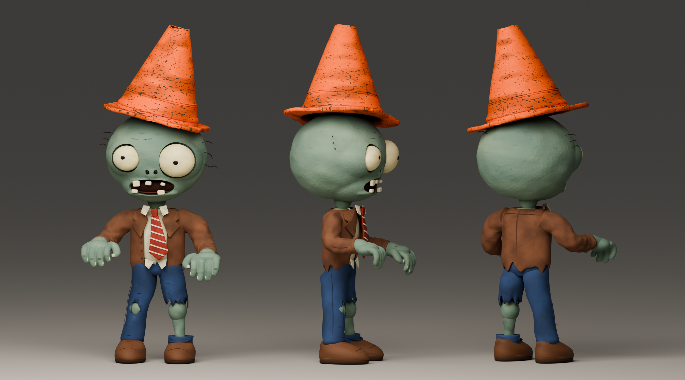

# 路障僵尸 · A 组参考模型

依据用户选定的 [A 组参考图](source/reference_A_approved.png)制作的独立高精度静态模型。存放于 `assets/3D/conehead_zombie`，没有接入原游戏，也没有修改已有普通僵尸文件。

## 打开模型

在 Blender 4.5 中用 **Ctrl＋O** 打开 [source/conehead_zombie.blend](source/conehead_zombie.blend)。源文件已打包贴图并保存摄影棚、相机和材质预览，打开后即可观察。把鼠标移到 3D 视图，按小键盘 **0** 进入相机视图；中键旋转、滚轮缩放，按 **Z → M** 进入材质预览，或 **Z → R** 使用场景渲染预览。

对象列表中的 `ConeheadZombie_Reference_A` 是整个人物，`TrafficCone_removable` 是路障父节点。路障外壳、内壁、顶端口沿、方形底座和三条模塑结构均独立命名，整只路障可以通过父节点一起移动、旋转或另行导出。

Godot 使用 [conehead_zombie.glb](conehead_zombie.glb)，无需安装 Blender；可将它拖入另建的预览场景。GLB 内嵌全部网格、材质与贴图，不包含摄影棚、灯光或相机。

## 参考与形状

身体以之前独立普通僵尸的副本为基础，保持五指、指甲、不对称眼睛、鼻孔、缺齿张口、破旧棕色西装、米白衬衣、红白条纹领带、深蓝破裤和圆头皮鞋。在新文件中缩短并加宽头部轮廓、保留饱满后脑，补充细微皮肤起伏，并移除被路障遮住的上部毛发。露出的小腿仍与头部和手采用相同灰绿色肤色。

路障按 A 图制作为略有凹陷的锥形空心塑料壳，侧倾 14°，壳体高度 0.88 m、壁厚约 0.012 m，圆角方形底座标称宽 0.98 m。顶部为带缺口的不规则开口，包含实际内壁与圆滑口沿；底座边缘有小缺口，下部有模塑套圈及两条窄凸筋。橙色塑料材质包含脏污、细小擦痕、磨损斑点、粗糙度和法线贴图，没有白色反光条。

A 图的三个人物是生成参考，局部细节并非严格一致；模型以其共同轮廓、倾角和材质为依据统一结构，实际模型预览见下方。

单位为米，含路障的高度约 3.28 m、宽度约 1.36 m、深度约 1.09 m，当前包含 263 个网格、665476 个三角面、25 个材质和 30 张内嵌贴图。Blender 为 Z 轴朝上、正面朝 −Y；GLB/Godot 为 Y 轴朝上、正面朝 +Z。实际统计见 [model_manifest.json](model_manifest.json)。这是静态参考模型，未绑定骨骼，未包含动画、碰撞体或游戏 LOD。

## 文件与复现

| 文件 | 内容 |
| --- | --- |
| [conehead_zombie.glb](conehead_zombie.glb) | 可直接导入 Godot 的二进制 glTF 2.0 |
| [source/conehead_zombie.blend](source/conehead_zombie.blend) | 可编辑最终模型，贴图已打包 |
| [source/base_normal_zombie.blend](source/base_normal_zombie.blend) | 生成时使用的普通僵尸副本，原文件保持不变 |
| [source/build_conehead.py](source/build_conehead.py) | 独立建模、贴图生成、打包和导出脚本 |
| [source/render_reference_views.py](source/render_reference_views.py) | 实际模型全身、头部、顶部与 A 组三角度渲染 |
| [source/validate_glb.py](source/validate_glb.py) | 文件结构、内嵌 PNG、法线/UV/切线与路障层级检查 |
| [source/check_asset.gd](source/check_asset.gd)、[source/capture_asset.gd](source/capture_asset.gd) | 在独立 Godot 临时工程中检查和渲染，按 `res://conehead_zombie.glb` 读取模型 |
| `source/textures/` | 独立颜色、法线、ORM 源贴图；橙色塑料和头部颜色图为 2048×2048 |
| [model_manifest.json](model_manifest.json) | Blender 实际统计和路障结构记录 |
| [validation_glb.json](validation_glb.json)、[validation_godot.json](validation_godot.json) | 最终文件结构及实际 Godot 导入检查结果 |
| [validation_blender.json](validation_blender.json) | 从保存文件重新加载后，核对网格统计、30 张打包贴图、独立源贴图与路障父子层级 |
| [delivery_checks.json](delivery_checks.json) | 图片完整性、文档链接、最终校验和与原模型/游戏文件未修改检查 |

```powershell
blender --background --threads 8 --python assets/3D/conehead_zombie/source/build_conehead.py
blender --background --threads 8 assets/3D/conehead_zombie/source/conehead_zombie.blend --python assets/3D/conehead_zombie/source/render_reference_views.py
python assets/3D/conehead_zombie/source/validate_glb.py
```

生成脚本仅写入当前模型目录，会覆盖其中的生成模型、贴图和预览；保留手工编辑结果时先复制源文件。只构建和导出、不渲染可在第一条命令后追加 `-- --skip-render`。验证 Python 脚本需要 Pillow。源文件和预览目录分别包含 `.gdignore`，不会让 Godot 自动扫描 Blender 源文件或检查脚本；游戏使用 GLB。

## 实际模型预览

下列图片均由同一个三维模型渲染，参考图片另存于 `source/reference_A_approved.png`。



| 视角 | 图片 |
| --- | --- |
| 正面 | [front.png](previews/front.png) |
| 斜前 | [three_quarter.png](previews/three_quarter.png) |
| 后侧 | [back.png](previews/back.png) |
| 侧面 | [side.png](previews/side.png) |
| 头部与路障 | [head_cone_close.png](previews/head_cone_close.png) |
| 顶部开口与底座 | [cone_top_close.png](previews/cone_top_close.png) |
| 头部侧面 | [head_cone_side.png](previews/head_cone_side.png) |
| Godot 材质预览 | [godot.png](previews/godot.png)，Compatibility 中性光照、关闭灯光投影 |
