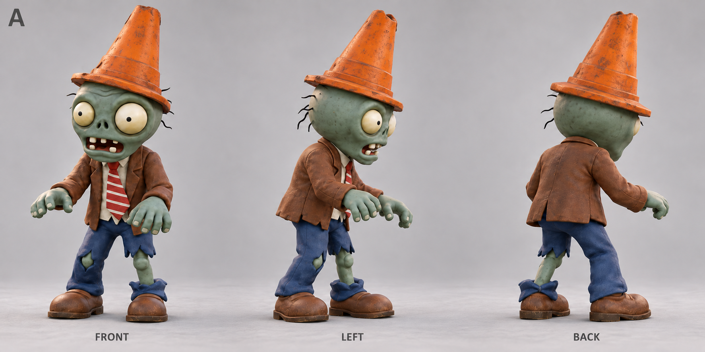
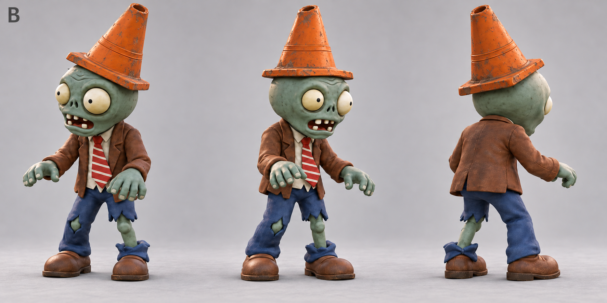
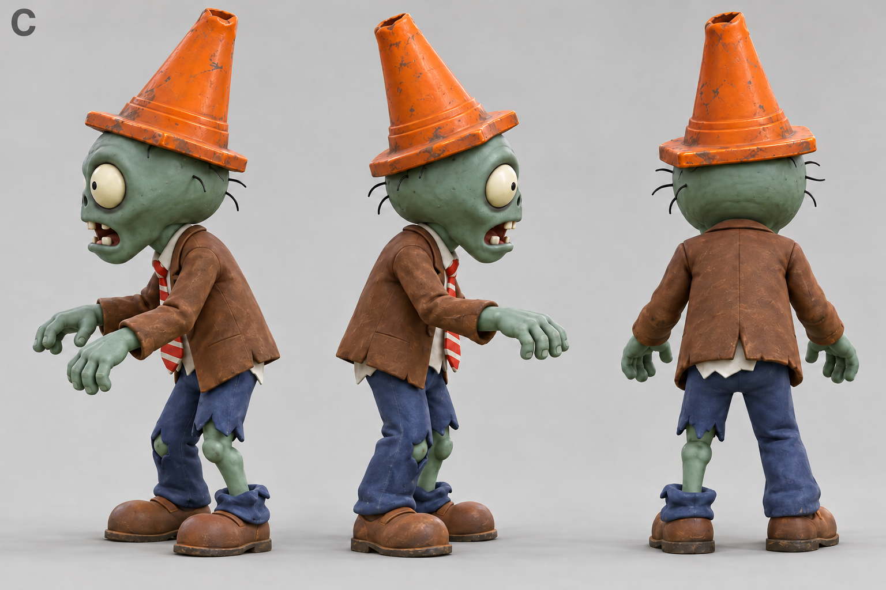
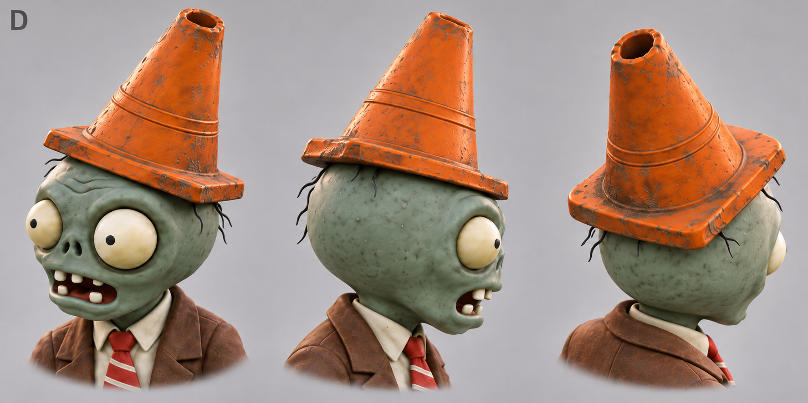

# 路障僵尸参考图 · 已选 A 组

2026-10-15，使用内置 imagegen，依据之前普通僵尸的[原始图片](2026-10-15/reference_original.png)与[已选定的 B 组参考](2026-10-15/reference_normal_B.png)，生成四套路障僵尸候选，共 12 个全身或头部视角。

保留普通僵尸饱满的灰绿色头部、不对称眼睛、破旧棕色西装、条纹领带、破裤和皮鞋，增加磨损橙色路障。三个全身候选中的裸露小腿均为灰绿色；C 的浅色小腿已另存修正版。

生成这些图片时仅提供候选参考，没有制作模型；生成记录保留当时的状态和普通僵尸文件校验和。用户随后选定 A 组，已据此制作[独立路障僵尸模型](../conehead_zombie/README.md)，没有修改已有普通僵尸或原游戏。其他候选保留用于对比，各套路障倾角、孔口和磨损细节存在差异。本目录包含 `.gdignore`，参考图不会被 Godot 扫描为游戏资源。

## 审查候选

| 编号 | 图片 | 重点 |
| --- | --- | --- |
| A | [全身正面偏斜、侧前与后侧](2026-10-15/A_front_side_rear.png) | 头身比例、路障尺寸、整体轮廓与材质 |
| B | [左右前斜角与后侧](2026-10-15/B_opposite_front_angles.png) | 两侧脸部、路障佩戴位置和倾斜方向 |
| C | [两侧轮廓与正背面](2026-10-15/C_profiles_back_green_shin.png) | 后脑厚度、路障侧面和底座、裤腿破损分布 |
| D | [头部斜前、侧面与俯视斜后近景](2026-10-15/D_head_cone_details.png) | 顶部孔口、边缘厚度、头顶接触位置及磨损 |

这些是生成的候选参考图，图中的角度文字是生成时的目标标签，不是精确的正交工程测量。可以整套选定，也可以明确指定某套的路障、某套的头型或材质作为建模依据。

### A · 全身轮廓

### B · 左右前斜角

### C · 两侧与背面

### D · 头部与路障近景

## 生成记录

- [完整生成、视角重做及肤色修改提示词](2026-10-15/generation_prompts.json)：使用内置 imagegen，包含被替换的 B 首稿记录；最终候选为 A、B_v2、C_green_shin_edit、D。
- [图片尺寸、SHA-256 与普通僵尸模型未修改检查](2026-10-15/manifest.json)。
- [C 肤色修改前的初稿](2026-10-15/C_profiles_back_initial.png)仅留作修改记录，审查请使用上面的灰绿色小腿修正版。

## 选定结果

用户选定 A 组，独立模型、Blender 源文件、实际转面和导入检查见[模型说明](../conehead_zombie/README.md)。本目录仍保留生成时的提示词与检查记录。
