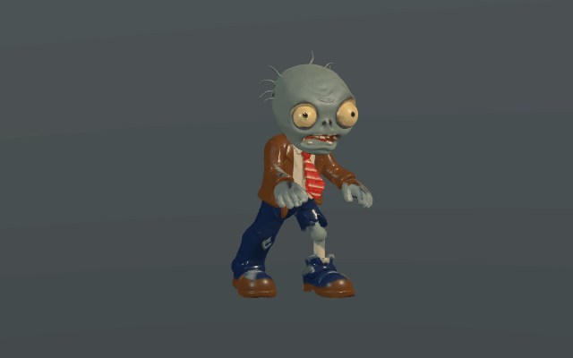
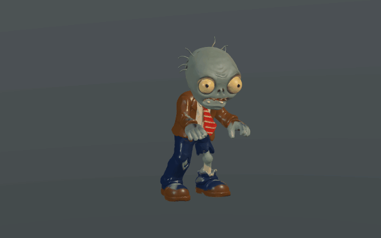
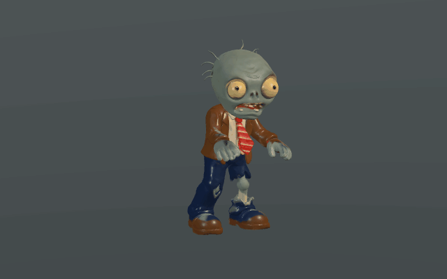

# 用户提供的僵尸 · 骨骼与动画

输入为用户提供的 `C:/Download/Edge/zombie character 3d model.glb`。原文件保持不变，原始副本保存于 [source/original_zombie.glb](source/original_zombie.glb)。在保留原网格、UV、材质和贴图的基础上，增加 25 根骨骼、每顶点最多 4 个蒙皮权重和五个动作。

## 在游戏里查看

运行项目，进入**演示模式**。五个大关与 **0 键原演示**中的普通僵尸使用本模型；原演示中按 **Z** 可近距离观察，鼠标拖动旋转、Ctrl＋滚轮缩放。

动作随实际状态切换：移动时拖步行走，接近植物时伸手、前倾并咀嚼，受击时短暂后缩，死亡时完整身体向后倒下，随后保持躺姿并清理。五个大关的啃食仍按原伤害计算；0 键原演示接触植物时播放啃食姿态，继续沿用其不结算植物啃食伤害的规则。

减速同步影响动作速度；冻结和场景树暂停保持当前骨骼姿态。死亡立即取消活体目标和碰撞，倒地身体独立于活体刷新：默认死亡 1 秒后刷新新僵尸，旧身体继续完成动作并按 `physics.parts.corpse.lifetime`（默认 5 秒）淡出。屋顶身体按当地坡面方向放置，R 或切换场景会清理身体。

其他僵尸类型与冒险模式沿用原模型。开关 `demo_zombie_animation.enabled` 默认为 `true`，设为 `false` 可使用原普通僵尸与其物理散件。开关在启动时读取，详见[配置说明](../../../config/README.md)。

## 文件与动作

| 文件 | 用途 |
| --- | --- |
| [zombie_animated.glb](zombie_animated.glb) | 游戏使用的蒙皮、骨骼、动作与三张内嵌贴图，无外部文件依赖 |
| [source/zombie_animated.blend](source/zombie_animated.blend) | 可编辑的骨骼、权重及动作源文件，贴图已打包 |
| [source/build_rig.py](source/build_rig.py) | 在 Blender 4.5 中重复生成骨骼、权重与动作 |
| [source/render_poses.py](source/render_poses.py) | 从实际保存的骨骼文件渲染姿势预览 |
| [source/validate_rig.py](source/validate_rig.py) | 检查原网格一致性、权重、关节、动画和内嵌图片 |
| [model_manifest.json](model_manifest.json) | 骨骼、各组权重顶点数、动作时长及原文件校验和 |
| [validation_rig.json](validation_rig.json) | 最终 GLB 的实际结构检查结果 |
| [validation_blender.json](validation_blender.json) | 重新打开源文件后的骨骼、动作和打包贴图检查 |
| [delivery_checks.json](delivery_checks.json) | 游戏回归、实际 GPU 检查与交付文件完整性记录 |

| 动作 | 时长 | 内容 |
| --- | --- | --- |
| Idle | 3.2 秒，循环 | 呼吸起伏、头部与双手的小幅摆动 |
| Walk | 1.1 秒，循环 | 左右腿交替、脚部落地与抬脚、躯干/头部反向摆动、领带和手部跟随 |
| Eat | 1.2 秒，循环 | 躯干前倾、双臂伸向植物、头部点动与下颌咀嚼 |
| Hit | 0.4 秒，单次 | 躯干、头部与双手的短暂受击反应，随后混合回当前动作 |
| Fall | 1.8 秒，单次 | 失衡、双臂反应、向后倒地与停留，按地面检查调整倒地高度 |

骨骼包含骨盆、脊柱、胸部、颈部、头、下颌、双侧上臂/前臂/手/手指、双侧大腿/小腿/脚/脚趾及两段领带。行走脚部采用两段腿部求解后烘焙到骨骼关键帧；游戏内的位移仍由原角色控制。默认显示高度为 1.82 世界单位，原模型高度为 1.0；整体大小继续乘以 `models.zombie.scale`，原 `Visuals/Head` 等细分部件配置对应旧的程序模型。

保留原高精度网格的 382770 个三角面，没有制作降面版本或 LOD。动作基于原有前伸双臂姿势制作，嘴部是下颌骨骼变形，没有增加表情形态键。

## Blender 中查看

用 **Ctrl＋O** 打开 `source/zombie_animated.blend`，选择 `ZombieRig`。在动画工作区的动作编辑器选择 `Idle`、`Walk`、`Eat`、`Hit` 或 `Fall`，按空格播放。选中骨架后进入姿态模式可调整骨骼，选中 `Zombie_SkinnedBody` 可检查各骨骼顶点组和权重。

重新生成与验证：

```powershell
blender --background --threads 8 --python-exit-code 1 --python assets/3D/imported_zombie/source/build_rig.py
blender --background --threads 8 assets/3D/imported_zombie/source/zombie_animated.blend --python assets/3D/imported_zombie/source/render_poses.py
python assets/3D/imported_zombie/source/validate_rig.py
```

独立 Python 验证需要 NumPy 和 Pillow。源文件与预览目录通过 `.gdignore` 排除 Godot 导入。重建会覆盖当前资产生成文件，保留手工编辑结果时先复制源文件。

## 实际预览

下列动图由 Godot Compatibility 对实际蒙皮与动作逐帧渲染。







实机截图：[行走](previews/demo_walk.png)、[啃食](previews/demo_eat.png)、[倒地](previews/demo_fall.png)。
