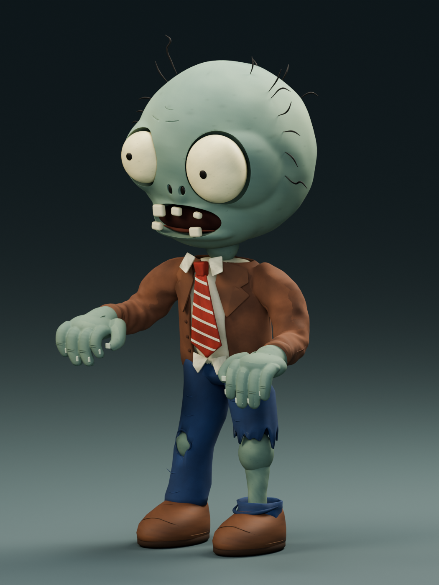
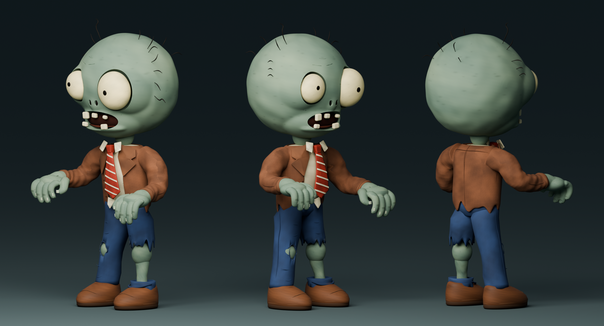

# 普通僵尸 · 独立参考模型

按用户提供的图片制作的完整三维静态模型，独立存放在 `assets/3D/normal_zombie`。2026-10-15 已依据用户选定的 [B 组灰绿色小腿参考图](source/reference_B_approved.png)优化头部、眼窝、服装、手部和材质。没有替换游戏现有僵尸，也没有修改游戏脚本、场景、配置、操作或数值。

## 文件

| 文件 | 用途 |
| --- | --- |
| [normal_zombie.glb](normal_zombie.glb) | 可直接导入 Godot 的二进制 glTF 2.0；网格、材质和贴图全部内嵌，无外部文件依赖。 |
| [source/normal_zombie.blend](source/normal_zombie.blend) | Blender 4.5.3 LTS 可编辑源文件；身体部件分别命名，贴图已打包，附有独立摄影棚和预览相机。 |
| [source/build_zombie.py](source/build_zombie.py) | 可复现建模、PBR 贴图、导出和三视角渲染的 Blender Python 脚本。 |
| [source/render_reference_views.py](source/render_reference_views.py) | 用真实模型渲染侧面、头部近景及 B 组对应的三角度转面图；不写入模型文件。 |
| [source/reference.png](source/reference.png) | 本次用户提供的参考图片。 |
| [source/reference_B_approved.png](source/reference_B_approved.png) | 用户选定的 B 组参考，露出的小腿采用灰绿色肤色。 |
| `source/textures/` | 原始颜色、切线空间法线和 ORM 贴图；颜色图使用 sRGB，法线与 ORM 使用非颜色数据。 |
| [previews/front.png](previews/front.png) | 正面预览。 |
| [previews/three_quarter.png](previews/three_quarter.png) | 四分之三视角预览。 |
| [previews/back.png](previews/back.png) | 背面预览。 |
| [previews/side.png](previews/side.png) | 真实模型的侧面，便于检查头部前后厚度。 |
| [previews/head_side.png](previews/head_side.png)、[previews/head_three_quarter.png](previews/head_three_quarter.png) | 头部近景。 |
| [previews/turnaround_B.png](previews/turnaround_B.png) | 同一个真实模型的左前、右前、右后转面，与 B 组角度对应。 |
| [previews/godot.png](previews/godot.png) | 独立 Godot 4.7.2 Compatibility 项目中性光照下的实际材质预览；预览灯光关闭投影。 |
| [model_manifest.json](model_manifest.json) | 实际网格数量、三角面、材质和尺寸记录。 |
| [validation_glb.json](validation_glb.json)、[validation_godot.json](validation_godot.json) | 文件结构和独立 Godot 导入检查的实际结果。 |

`source/.gdignore` 隔离 Blender 源文件和建模脚本，Godot 使用 GLB 时无需安装 Blender。预览目录也与游戏资源导入隔离。项目根目录的 `artifacts/.gdignore` 另外隔离临时下载的 Blender 运行时和验证工程，避免编辑器尝试导入 Blender 自带的 GLSL；这个隔离文件保留在 Git 中。看到 `res://artifacts/zombie_model/blender-...` 的历史加载错误时，关闭错误弹窗并重新打开项目即可重新扫描。

## 形状与材质

模型包含灰绿色大头、大小不同的泛黄眼球、小黑瞳孔、凹陷眼窝和鼻孔、张口与五颗不齐的牙齿、额头皱纹、稀疏弯曲头发、弯曲手臂、每只手五根手指与指甲。服装包含棕色敞开西装、连续的肩部/袖子、折叠驳领与袖口、三颗前襟纽扣、米白衬衣与不齐下摆、红色斜条纹领带、深蓝破裤、真正贯穿裤布的膝盖破洞、露出的灰绿色膝盖和小腿、脚踝裤布与圆头皮鞋。

本轮优化把头部主体的前后厚度从约 0.723 m 增至 0.967 m，宽度从约 0.907 m 调整为 0.930 m，高度从约 1.023 m 调整为 0.956 m；厚度/宽度由约 0.80 变为 1.04，使后脑更饱满、轮廓更圆。眼窝、脸颊与嘴唇采用连续雕刻表面，暗色仅用于眼窝深处；额头/眼下皱纹采用浅凹槽。扩大手掌和弯曲手指，柔化衣领、袖根和驳领，重做裤子褶皱与贴合鞋面的缝线，并增加鞋面体积。三角面由 703986 个降至 573975 个；这是高精度静态资源，不含游戏 LOD 或动画。

九个主要材质使用颜色、粗糙度和法线贴图，分别表现皮肤、灰绿色小腿、棕色布料、驳领、牛仔布、衬衣、领带、皮革与眼球；其余牙齿、瞳孔、毛发、指甲、嘴内、缝线等使用独立材质。包含 23 个材质、27 张内嵌贴图，皮肤贴图提升为 2048×2048。小腿与脸/手采用相同的灰绿色基色，加入皮肤斑驳、布料织纹和皮革磨损；粗糙度采用 ORM 绿色通道，所有材质为非金属。

当前参考包括原始正面图片与用户选定的 B 组转面图；未展示的结构按同一风格补全。当前是保持参考姿势的高精度模型，未绑定骨骼、未制作动画或碰撞体。

## 打开与导入

在 Godot 中将 `normal_zombie.glb` 拖入**另建的预览场景**即可检查模型；本次没有接入原游戏。源文件可直接用 Blender 4.5 打开，在 `NORMAL_ZOMBIE | reference model` 集合里编辑部件。`STUDIO` 集合的地面、灯光和相机仅用于预览，GLB 中不包含这些对象。

单位为米，包含头发的高度约 2.64 m、宽度约 1.36 m、深度约 1.10 m，原点位于双脚之间的地面附近。Blender 中 Z 轴朝上、正面朝 −Y；GLB/Godot 中 Y 轴朝上、正面朝 +Z。

重新生成时运行：

```powershell
blender --background --threads 8 --python assets/3D/normal_zombie/source/build_zombie.py
blender --background assets/3D/normal_zombie/source/normal_zombie.blend --python assets/3D/normal_zombie/source/render_reference_views.py
python assets/3D/normal_zombie/source/validate_glb.py
```

生成脚本只写入本模型目录，不打开原游戏；会覆盖该目录内的生成模型、贴图和 Blender 预览。需要保留手工编辑结果时先复制源文件。只导出、不渲染可在 Blender 命令后加 `-- --skip-render`。

本轮优化前的本地模型、源文件、生成脚本和预览备份位于 `artifacts/zombie_model/before_B_optimization`，该临时目录不随版本库提交。旧版浅色小腿贴图仅作为历史源文件保留，新 GLB 使用灰绿色小腿材质。




