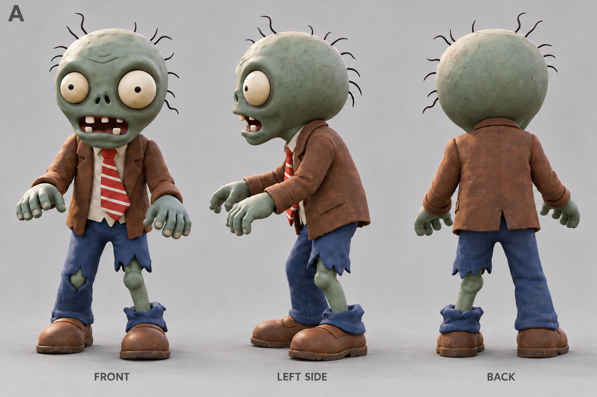
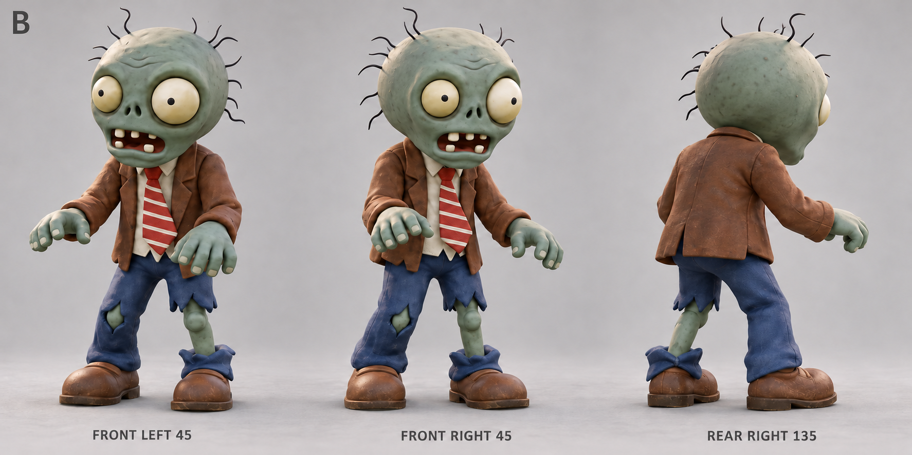
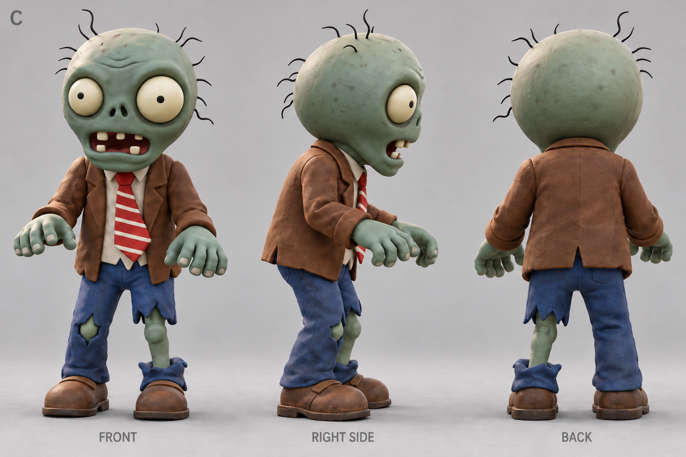
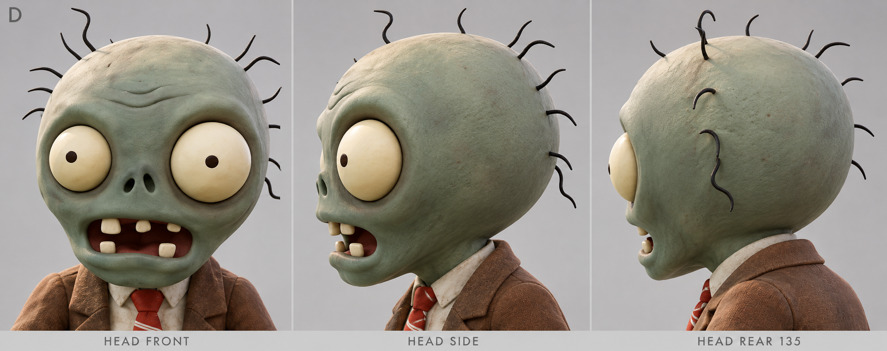

# 普通僵尸三视图候选

2026-10-15，使用内置 imagegen，依据用户提供的[原始图片](2026-10-15/reference.png)生成四套不同角度的参考图，供挑选头型、前后厚度、眼窝、服装及姿势。侧面与背面按单张正面图片补全。

当前 A、B、C 均采用用户要求的新版肤色：左腿膝盖下露出的小腿已统一为与膝盖、脸、手协调的灰绿色。正面图中这条腿在画面右侧，背面图中在画面左侧。D 为头部近景，无需修改小腿。初版图片也保留在同一目录，便于对比。

生成这些参考图片期间，`normal_zombie.glb` 与 `normal_zombie.blend` 未修改，检查记录保留当时的校验和。用户随后选定 B 组；2026-10-15 已据此[优化独立模型](../normal_zombie/README.md)，游戏内容仍保持原样。本目录的 `.gdignore` 将参考图片与游戏资源导入隔离。

## 最新候选

| 编号 | 视角 | 适合比较 |
| --- | --- | --- |
| [A](2026-10-15/A_standard_front_left_back_green_shin.png) | 全身正面、左侧、背面 | 整体比例、侧面后脑厚度与服装结构 |
| [B](2026-10-15/B_three_quarter_turnaround_green_shin.png) | 左前、右前、右后斜角 | 脸部立体感、左右眼窝、手与衣服体积 |
| [C](2026-10-15/C_standard_front_right_back_green_shin.png) | 全身正面、右侧、背面 | 另一侧轮廓、头身比例与裤腿破损 |
| [D](2026-10-15/D_head_volume_three_views.png) | 头部正面、侧面、后侧近景 | 头型、脸颊、下颌和后脑体积 |

图中的角度标签描述生成时的目标视角。可以整套挑选，也可以指定某一套的头型、另一套的衣服作为后续建模参考。

### A · 正面 / 左侧 / 背面

### B · 左右前方 / 右后方

### C · 正面 / 右侧 / 背面

### D · 头部体积近景

## 生成记录与初版

- [四套初始生成提示词](2026-10-15/generation_prompts.json)
- [A/B/C 小腿肤色修改提示词](2026-10-15/edit_prompts.json)
- [图片尺寸、校验和与模型未修改检查记录](2026-10-15/manifest.json)
- 初版：[A](2026-10-15/A_standard_front_left_back.png)、[B](2026-10-15/B_three_quarter_turnaround.png)、[C](2026-10-15/C_standard_front_right_back.png)
